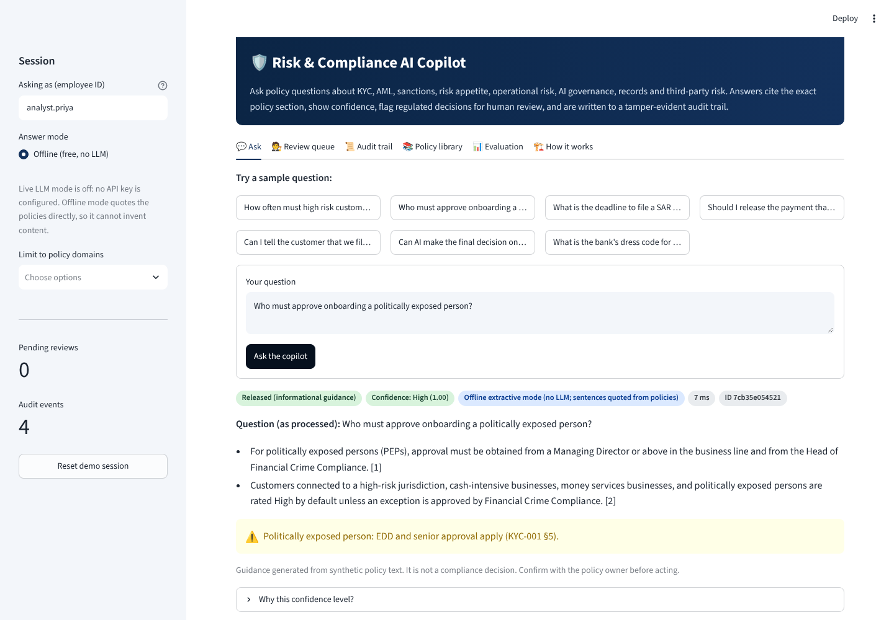

# 01 · Enterprise Banking Risk & Compliance AI Copilot

A retrieval-augmented (RAG) policy assistant for a **fictional bank (Ledgerline Bank)**. It answers employees' KYC, AML, sanctions, risk-appetite, operational-risk, AI-governance, records and third-party-risk questions **only from approved policy text**, with section-level citations, a confidence indicator, risk flags, human review and a tamper-evident audit trail.

> Independent, AI-assisted portfolio project. All data is synthetic. Not affiliated with any real institution.



## What it does

| Capability | Where |
|---|---|
| Ingest and validate policy documents (front matter, sections, PII rejection) | `copilot/documents.py`, Policy library tab |
| Hybrid retrieval: BM25 + dense LSA vectors, Reciprocal Rank Fusion, acronym and synonym expansion | `copilot/retriever.py` |
| Cited answers: offline extractive (default, free) or live Claude (opt-in) with citation validation | `copilot/answering.py`, `portfolio_core/llm.py` |
| Confidence score with reasons; Low confidence → no answer, referred to Compliance | `assess_confidence` |
| Risk flags: sanctions release, tipping-off, regulated decisions, policy exceptions, PEPs | `RISK_RULES` |
| Guardrails: PII redaction, prompt-injection blocking, input limits | `portfolio_core/guardrails.py` |
| Human-in-the-loop review queue with maker-checker and mandatory rationale | `copilot/review.py`, Review queue tab |
| SHA-256 hash-chained audit log with verification and export | `portfolio_core/audit.py`, Audit trail tab |
| Live evaluation on a 37-question golden set | `copilot/evaluation.py`, Evaluation tab |

## Verified results (this build)

| Check | Result |
|---|---|
| Unit and integration tests (`pytest`) | 48 passed |
| Golden-set evaluation, offline mode | Recall@1 0.94 · Recall@3 1.00 · MRR 0.97 · answer facts 0.97 · citation validity 1.00 · routing 1.00 ([report](docs/evaluation/eval_report.md)) |
| End-to-end browser test (Playwright, 10 steps against the running app) | All passed, with screenshots in `docs/screenshots/` |
| MLflow logging of evaluation metrics | Verified locally (`--mlflow`) |
| Live Claude mode | Implemented and unit-tested with a mocked client. **Not yet run against the real API** (needs an approved key). |
| Public hosted URL | **Pending** GitHub connection and Streamlit Community Cloud deploy |

## Run it

From the repository root:

```bash
pip install -r requirements-dev.txt
streamlit run projects/p1_compliance_copilot/app.py      # the app
pytest                                                   # tests
python projects/p1_compliance_copilot/evaluate.py        # evaluation report
```

Optional live LLM mode: set `ANTHROPIC_API_KEY` (and optionally `PORTFOLIO_LLM_MODEL`) as an environment variable or in Streamlit secrets. Never commit keys.

## Documentation

- [Architecture, diagrams, trade-offs, security, cost and limitations](docs/architecture.md)
- [Interview pack: summary, demo scripts, 36 Q&A, resume lines, your role](docs/interview_pack.md)
