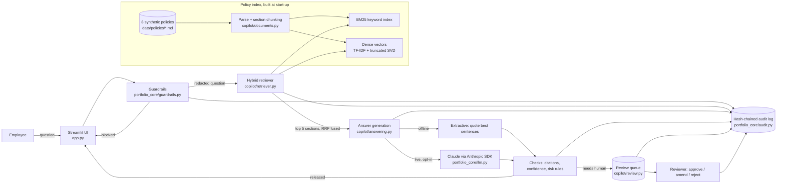
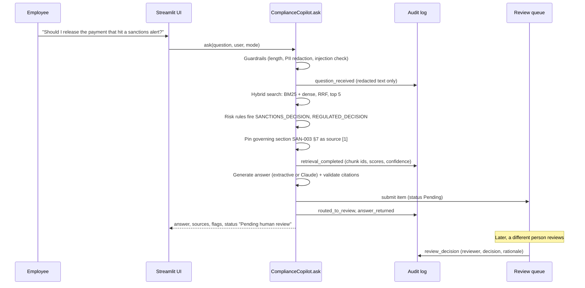

# Architecture: Enterprise Banking Risk & Compliance AI Copilot

## 1. Context

Employees in a bank ask policy questions all day: "How often do we refresh KYC for a high-risk customer?", "What is the SAR filing deadline?", "Can I release this sanctions hit?". The answers sit in long policy documents, and getting one wrong is a regulatory risk. The copilot answers from approved policy text only. Every answer cites its sources, shows a confidence level, and routes regulated or uncertain questions to a human reviewer. Every step is written to a tamper-evident audit trail.

All policies describe **Ledgerline Bank**, a fictional bank. No real bank, customer or employer data is used.

## 2. Component view

## 3. Request flow (one question)

## 4. Routing rules

| Situation | Status shown | Goes to review queue? |
|---|---|---|
| Empty, too long, or prompt-injection pattern | Blocked by guardrails | No (blocked and logged) |
| Confidence Low, or the LLM says the evidence is insufficient | No supported answer, referred to Compliance | Yes. No answer text is shown. |
| A risk rule that requires review fires (sanctions release, tipping-off, regulated decision, policy exception) | Pending human review | Yes |
| Confidence High or Medium and no blocking rule | Released (informational guidance) | No |

Confidence score = 0.6 × (share of the question's key terms found in the top 3 sources) + 0.4 × (best semantic similarity ÷ 0.5, capped at 1). High is 0.70 or above, Medium is 0.45 or above, and anything lower is Low.

## 5. Key design decisions and trade-offs

| Decision | Why | Trade-off |
|---|---|---|
| Section-level chunks (one chunk per numbered policy section) | Citations map to something a compliance officer recognises ("SAN-003 §7") | Very long sections are split on paragraphs with one paragraph of overlap |
| Hybrid retrieval (BM25 + dense vectors, Reciprocal Rank Fusion) | Keyword search catches exact terms (CTR, 85 percent); dense vectors catch paraphrases | Two indexes to maintain; RRF ignores raw score magnitudes |
| Local LSA embeddings instead of a hosted embedding API | Free, offline, deterministic, so tests are repeatable and nothing leaves the app | Weaker semantics than modern neural embeddings. The `DenseIndex` class can be swapped for Databricks Vector Search or a hosted embedding model. |
| Offline extractive answers by default | Zero cost, cannot hallucinate because every sentence is quoted verbatim | Less fluent than an LLM summary |
| Live LLM is opt-in, grounded, and its citations are validated | Better answers when budget allows. Invented citations cause a fallback to offline mode. | Needs an API key and spending approval. Not verified live in this build. |
| Rule-based risk flags | Transparent and auditable; each rule points to the policy section that requires it | Keyword rules can miss unusual phrasing; they complement the confidence check rather than replace it |
| SQLite with a SHA-256 hash chain for audit | Tamper evidence without extra infrastructure | Per-session storage in the hosted demo; a production system would use a managed database or Delta table |
| Maker-checker on reviews | Mirrors banking four-eyes control | Reviewer identity is self-declared in the demo; production would use single sign-on |

## 6. Security and privacy controls

- PII (emails, card numbers, IBANs, SSNs, phone and account numbers) is redacted **before** retrieval, LLM calls or logging. Policy uploads that contain PII are rejected.
- Prompt-injection patterns are blocked. The LLM prompt wraps sources and question in tags and tells the model to treat them as data.
- The API key is read only from an environment variable or Streamlit secrets. It is never shown or logged. `.streamlit/secrets.toml` is git-ignored.
- AI never makes the regulated decision. The governing policy (MRM-006 §5) is shown and the item is routed to a human.

## 7. Cost

| Component | Cost |
|---|---|
| Offline mode (default) | $0 |
| Streamlit Community Cloud hosting | $0 (free tier) |
| GitHub public repository + Actions CI | $0 |
| Optional live Claude mode | Roughly 1,500 input + 300 output tokens per question. That is well under one US cent per question on the smaller Claude models. It needs an API key and your approval before any spend. |

## 8. Limitations (stated honestly)

- The evaluation set (37 questions) was written by the same AI-assisted process as the policies, and the answer-selection threshold was tuned on it. The metrics show the system works as designed on its own test set. They are not an independent benchmark.
- LSA embeddings are trained on only 8 documents, so paraphrases far from the policy wording can be missed.
- Hosted-demo state (audit log, review queue, uploads) lasts for one browser session.
- Live LLM mode is implemented and unit-tested with a mocked client, but has not been run against the real API in this build.
