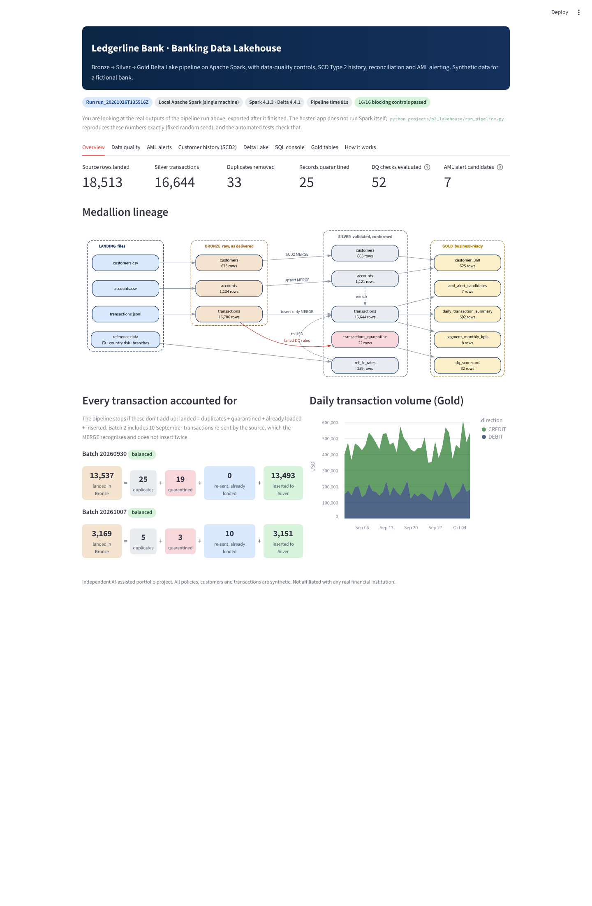

# 02 · Banking Data Engineering Lakehouse

A Bronze → Silver → Gold **Delta Lake** pipeline on **Apache Spark** for a **fictional bank (Ledgerline Bank)**. It lands core-banking extracts, validates them with 18 declarative data-quality rules, quarantines bad records with reasons, keeps SCD Type 2 customer history, prevents double-counting of re-sent payments, and publishes AML alert candidates, a customer 360 view and KPIs. Every step has to reconcile, or the run stops.

> Independent, AI-assisted portfolio project. All data is synthetic. Not affiliated with any real institution.



## What it does

| Capability | Where |
|---|---|
| Synthetic source extracts with a control-total manifest, planted defects and AML scenarios, and an answer key | `lakehouse/synthetic.py` |
| Bronze: raw strings, row-level lineage, idempotent loads, manifest reconciliation (blocking) | `lakehouse/bronze.py` |
| Declarative expectations (warn / drop / fail), quarantine, per-rule metrics | `lakehouse/dq.py` |
| Silver: `try_cast` typing, de-duplication, PII hashing and masking, FX to USD, SCD2 / upsert / insert-only Delta MERGEs, reconciliation | `lakehouse/silver.py` |
| Gold in Spark SQL: AML alert candidates, customer 360, daily summary, segment KPIs (SCD2 as-of join), DQ scorecard | `lakehouse/sql/gold/*.sql` |
| Change Data Feed, time travel, schema enforcement, OPTIMIZE + Z-ORDER, run and DQ audit tables | `lakehouse/pipeline.py`, `store.py` |
| Same code on Databricks: Unity Catalog tables, a Lakeflow Jobs DAG, governance (tags, column masks) | `databricks/` |
| Streamlit explorer: lineage, reconciliation, DQ, AML drill-down, SCD2, time travel, sandboxed SQL console | `app.py`, `explorer.py` |

## Verified results (this build)

| Check | Result |
|---|---|
| Full pipeline run, local Spark 4.1.3 + Delta 4.4.1 | 18,513 source records → 16,644 Silver transactions in about 80 s; 16/16 blocking controls passed |
| Planted facts found | All 22 transaction defects, 33 duplicates, 10 cross-batch re-sends, 40 SCD2 changes and 7 AML scenarios. Nothing extra |
| Automated tests (`pytest`) | 44 passed for this project (92 in the repo), including real Spark/Delta end-to-end runs |
| Browser test (Playwright, 8 steps against the running app) | All passed; screenshots in `docs/screenshots/` |
| GitHub Actions CI | Installs Java 17, runs all tests and the pipeline |
| **Databricks Free Edition run** | **Not yet run.** The notebooks are ready; this needs the owner's workspace |
| **Public hosted URL** | **Not yet deployed** |

## Run it

From the repository root (needs Java 17+ for the pipeline):

```bash
pip install -r requirements-dev.txt
python projects/p2_lakehouse/run_pipeline.py          # build the lakehouse and refresh the app snapshot
streamlit run projects/p2_lakehouse/app.py            # the explorer (no Java needed)
pytest projects/p2_lakehouse                          # tests
```

### On Databricks Free Edition

1. In your workspace: **Workspace → Create → Git folder**, paste `https://github.com/nipunrg1990rocks-dev/banking-ai-portfolio`.
2. Open `projects/p2_lakehouse/databricks/00_run_pipeline` and click **Run all** (serverless; a few minutes).
3. Optional: run `01_create_job` to create the 6-task **Ledgerline Lakehouse** job, then `02_unity_catalog_governance`.

## Documentation

- [Architecture, diagrams, data model, controls, security, cost and limitations](docs/architecture.md)
- [Interview pack: summary, demo scripts, 38 Q&A, code walkthrough, resume lines, your role](docs/interview_pack.md)
