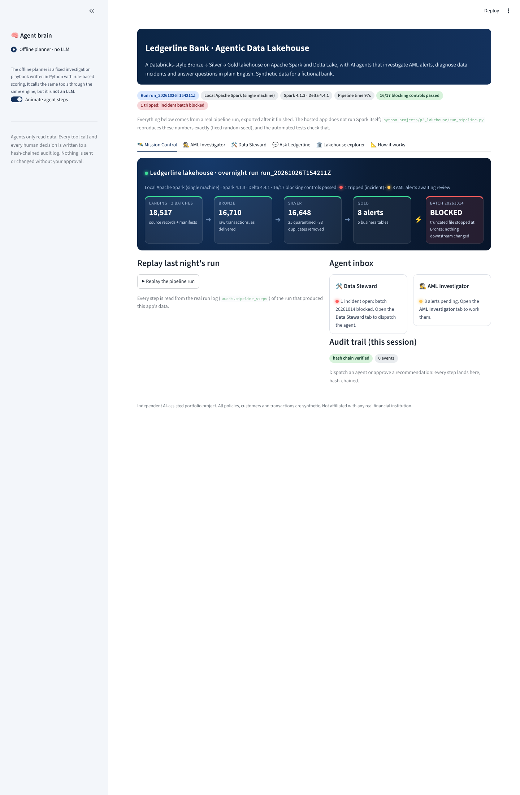
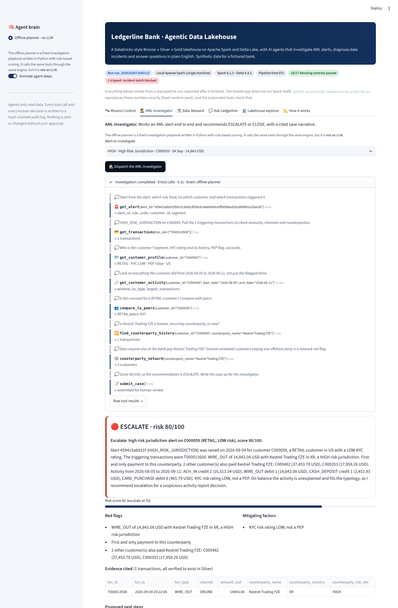

# 02 · Agentic Banking Lakehouse

A Bronze → Silver → Gold **Delta Lake** pipeline on **Apache Spark** for a **fictional bank (Ledgerline Bank)**. It lands core-banking extracts, validates them with 18 declarative data-quality rules, quarantines bad records with reasons, keeps SCD Type 2 customer history, prevents double-counting of re-sent payments, and publishes AML alert candidates, a customer 360 view and KPIs. Every step has to reconcile, or the run stops.

On top of the lakehouse sit **three AI agents** that investigate what the pipeline produced, using read-only tools, and hand their conclusions to a person to approve:

- **AML Investigator** works an alert: pulls the transactions, the customer profile, 90-day behaviour, peer comparison and counterparty network, then recommends ESCALATE or CLOSE with a scored, evidence-cited case narrative.
- **Data Steward** explains a blocked load: reads the pipeline audit, the DQ results and the delivery files themselves (bytes, checksum, last line), finds the root cause and drafts the ticket.
- **Ask Ledgerline** answers business questions in plain English with SQL and a chart.

> Independent, AI-assisted portfolio project. All data is synthetic. Not affiliated with any real institution.





## What it does

| Capability | Where |
|---|---|
| Synthetic source extracts with a control-total manifest, planted defects and AML scenarios, and an answer key | `lakehouse/synthetic.py` |
| Bronze: raw strings, row-level lineage, idempotent loads, manifest reconciliation (blocking) | `lakehouse/bronze.py` |
| Declarative expectations (warn / drop / fail), quarantine, per-rule metrics | `lakehouse/dq.py` |
| Silver: `try_cast` typing, de-duplication, PII hashing and masking, FX to USD, SCD2 / upsert / insert-only Delta MERGEs, reconciliation | `lakehouse/silver.py` |
| Gold in Spark SQL: AML alert candidates, customer 360, daily summary, segment KPIs (SCD2 as-of join), DQ scorecard | `lakehouse/sql/gold/*.sql` |
| Change Data Feed, time travel, schema enforcement, OPTIMIZE + Z-ORDER, run and DQ audit tables | `lakehouse/pipeline.py`, `store.py` |
| Same code on Databricks: Unity Catalog tables, a Lakeflow Jobs DAG, governance (tags, column masks) | `databricks/` |
| AI agents: 14 read-only tools, strict submit schemas, tool-call limits, hash-chained audit log; Claude brain and an offline (no-LLM) planner | `agents/` |
| Agent evaluation against the generator's answer key | `agents/evals.py`, `run_agents.py` |
| Agents on Databricks: read Unity Catalog tables, write case reports and agent steps to Delta | `databricks/03_ai_agents.py`, `agents/lakehouse_io.py` |
| Streamlit app: Mission Control, agent traces, human approval, chat, lineage, DQ, SCD2, time travel, sandboxed SQL console | `app.py`, `agent_ui.py`, `explorer.py` |

## Verified results (this build)

| Check | Result |
|---|---|
| Full pipeline run, local Spark 4.1.3 + Delta 4.4.1 | 18,517 source records → 16,648 Silver transactions in about 100 s; 16 of 17 blocking controls passed and 1 tripped on purpose: the truncated delivery 20261014 was blocked at Bronze and Silver/Gold versions did not change |
| Planted facts found | All 22 transaction defects, 33 duplicates, 10 cross-batch re-sends, 40 SCD2 changes 7 genuine AML scenarios and 1 planted false positive (a payroll cycle). Nothing extra |
| Automated tests (`pytest`) | 58 passed for this project (106 in the repo), including real Spark/Delta end-to-end runs and the agents on a live local Spark lakehouse |
| Agent evaluation, offline planner (no LLM) | AML Investigator 8/8 alerts fully correct (7 ESCALATE, the false positive CLOSED, trigger transactions cited, no invented ids); Data Steward 1/1 (TRUNCATED_FILE, 3,150 expected, 2,835 received, 315 missing); Ask Ledgerline 6/6 answers match reference SQL |
| **Agents on Databricks with a free Foundation Model** | `00_run_pipeline` (new data version) and `03_ai_agents` reported done by Nipun on 2026-10-26 (no screenshot; which free model was used and its scores were not captured). Scores for an LLM brain are therefore not quoted anywhere |
| Agent evaluation, Claude API | Not run: the owner chose Databricks free models instead of paid API calls |
| Browser test (Playwright, 12 steps against the running app) | All passed; screenshots in `docs/screenshots/` |
| GitHub Actions CI | Installs Java 17, runs all tests and the pipeline |
| **Databricks Free Edition run** (checked by Nipun, 2026-10-26) | `00_run_pipeline` ran end to end on serverless (Spark 4.2.0) in 356 s, run `run_20261026T144959Z`. Table counts match the local run of that data version exactly: 16,644 Silver transactions, 22 + 1 + 2 quarantined. All blocking controls passed, because the run would have stopped otherwise. Evidence: [`docs/evidence/databricks_run_20261026.png`](docs/evidence/databricks_run_20261026.png). The newer data version (incident batch, payroll false positive) and the agents notebook (`03`) were then run too; see the next row. The job DAG (`01_create_job`) and the governance SQL (`02`) have not been run yet |
| **Public hosted URL** | **Not yet deployed** |

## Run it

From the repository root (needs Java 17+ for the pipeline):

```bash
pip install -r requirements-dev.txt
python projects/p2_lakehouse/run_pipeline.py          # build the lakehouse and refresh the app snapshot
streamlit run projects/p2_lakehouse/app.py            # the app (no Java needed)
python projects/p2_lakehouse/run_agents.py            # score the agents (offline planner, free)
python projects/p2_lakehouse/run_agents.py --brain claude --record   # Claude; needs ANTHROPIC_API_KEY, costs money
pytest projects/p2_lakehouse                          # tests
```

### On Databricks Free Edition

1. In your workspace: **Workspace → Create → Git folder**, paste `https://github.com/nipunrg1990rocks-dev/banking-ai-portfolio`.
2. Open `projects/p2_lakehouse/databricks/00_run_pipeline` and click **Run all** (serverless; a few minutes).
3. Open `03_ai_agents` and click **Run all**: the agents investigate the live tables using a free Databricks Foundation Model endpoint (picked automatically, no API key) and are scored against the answer key.
4. Optional: run `01_create_job` to create the 6-task **Ledgerline Lakehouse** job, then `02_unity_catalog_governance`.

## Documentation

- [Architecture, diagrams, data model, controls, security, cost and limitations](docs/architecture.md)
- [Interview pack: summary, demo scripts, 46 Q&A (8 on the AI agents), code walkthrough, resume lines, your role](docs/interview_pack.md)
