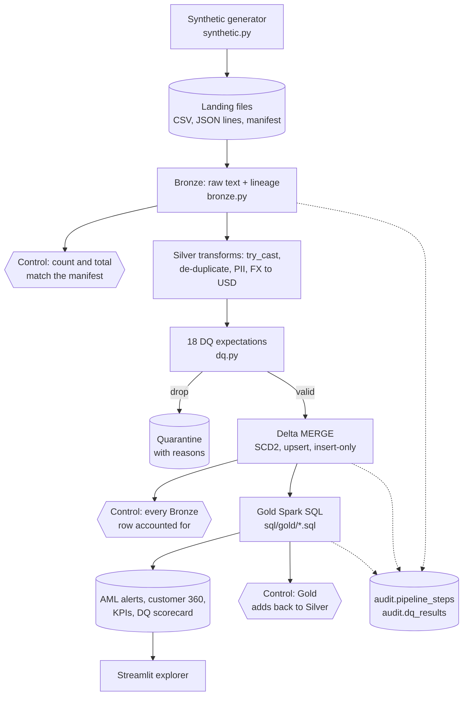
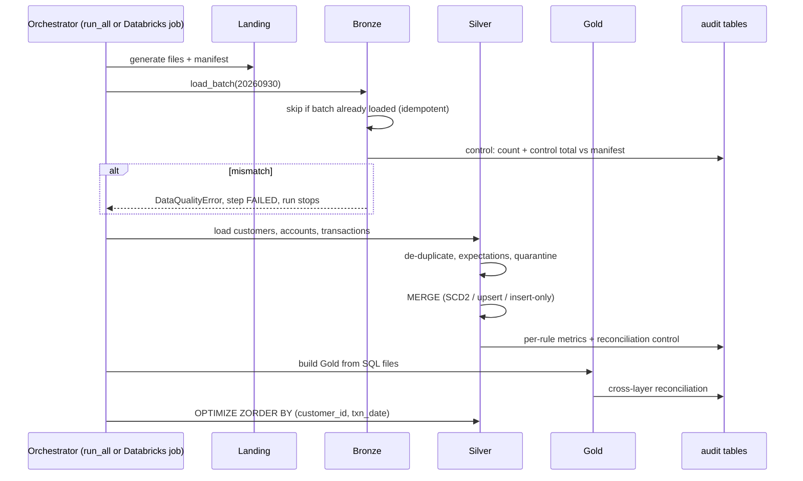

# Architecture: Banking Data Engineering Lakehouse

## 1. Context

Banks run on data that arrives late, twice, or broken: a core-banking extract with a missing amount, a payment file re-sent after a timeout, a customer whose KYC risk rating changed overnight. Risk, finance and financial-crime teams still need numbers they can trust and trace back to source. This project builds that foundation for **Ledgerline Bank**, a fictional bank. It is a lakehouse that lands source files, validates and conforms them, keeps full history, and publishes business-ready tables with evidence that nothing was lost or double-counted.

All data is synthetic, generated from a fixed seed. No real bank, customer or employer data is used.

## 2. Component view

The `TableStore` class (`lakehouse/store.py`) is the only code that knows where a table lives. Locally a table is a Delta folder, referenced as `` delta.`…/silver/transactions` ``. On Databricks it is a Unity Catalog table, `workspace.ledgerline_silver.transactions`. Everything else is identical, so the code that runs in CI is the code that runs on Databricks.

## 3. Run flow (one batch)

On Databricks, `databricks/01_create_job.py` creates the same flow as a **Lakeflow Jobs** DAG: `land → reference → batch_20260930 → batch_20261007 → gold → optimize`. All tasks share one `run_id`, so the audit tables read the same way as a local run.

## 4. Data model

| Layer | Table | Grain | Key points |
|---|---|---|---|
| Bronze | `customers`, `accounts`, `transactions` | one row per delivered record | Strings only, append-only, lineage columns |
| Bronze | `ref_fx_rates`, `ref_country_risk`, `ref_branches` | one row per reference record | Full refresh |
| Silver | `customers` | one row per customer **version** | SCD Type 2: `effective_from`, `effective_to`, `is_current`, `record_hash`. E-mail stored as SHA-256, phone masked. Invalid KYC rating defaults to HIGH (fail-safe) |
| Silver | `accounts` | one row per account | SCD Type 1 upsert on status, product and limit changes |
| Silver | `transactions` | one row per `txn_id` | Typed amounts, `amount_usd` at the daily FX rate, direction, counterparty risk tier, `dq_warnings` |
| Silver | `*_quarantine` | one row per rejected record | Raw values kept, plus `_dq_failed_rules` |
| Gold | `aml_alert_candidates` | one row per alert | Rule, rationale, transaction ids, priority, always `PENDING_REVIEW` |
| Gold | `customer_360` | one row per current customer | Profile, holdings, 30-day activity, alerts. No names or contact details |
| Gold | `daily_transaction_summary` | date × type × channel × direction | Counts and USD totals |
| Gold | `segment_monthly_kpis` | month × segment | Joins transactions to the customer version valid **on the transaction date** |
| Gold | `dq_scorecard` | rule × table for the latest run | Rows checked, failed, pass rate, status |
| Audit | `pipeline_steps`, `dq_results` | one row per step/table, per rule | Run log and DQ evidence for every run |

## 5. Data-quality rules and controls

| Table | Rule | Action |
|---|---|---|
| customers | `customer_id_present`, `valid_segment` | drop |
| customers | `valid_risk_rating` (defaults to HIGH), `valid_email`, `dob_present`, `known_country` | warn |
| accounts | `account_id_present`, `known_customer`, `valid_currency`, `valid_status` | drop |
| transactions | `txn_id_present`, `amount_present`, `amount_positive`, `valid_currency`, `valid_timestamp`, `not_future_dated`, `known_account`, `fx_rate_available` | drop |

Blocking controls (action `fail`) stop the run and log the step as FAILED:

1. Bronze row count equals the source manifest, per file and batch.
2. The Bronze amount total equals the manifest control total.
3. Silver reconciliation per entity: Bronze = duplicates + quarantined + valid, and for transactions, valid = inserted + already loaded.
4. The Gold daily summary adds back to Silver in count and USD value.
5. Gold segment KPIs cover every Silver transaction, which proves the SCD2 as-of join is complete.

In the committed run, every planted defect was caught and nothing else was quarantined. That gives 25 rows quarantined and 33 duplicates removed, and all 16 blocking controls passed.

## 6. Delta Lake features used

| Feature | Where | Why it matters in a bank |
|---|---|---|
| ACID MERGE | `silver.py` | A batch is applied completely or not at all, so readers never see half a load |
| SCD Type 2 via MERGE | `load_customers` | You can answer "what was this customer's rating when the payment happened?" |
| Insert-only MERGE | `load_transactions` | A re-sent payment file cannot double-count money |
| Time travel (`VERSION AS OF`) | tests, app | Reproduce a report exactly as it was, for audit or incident review |
| Change Data Feed | Silver tables | Downstream systems consume only what changed |
| Schema enforcement | test | A bad upstream change fails loudly instead of corrupting a table |
| OPTIMIZE + Z-ORDER | `pipeline.optimize` | Fewer, better-organised files, so investigator queries skip irrelevant data |
| `_metadata.file_path` | `bronze.py` | Row-level lineage back to the delivered file |

## 7. Security and privacy

- Synthetic data only. High-risk jurisdictions use fictional ISO user-assigned codes (XR, XS, XE), so the data makes no claims about real countries.
- PII minimisation by layer. Bronze keeps the raw delivery, as a restricted evidence copy. Silver stores a hashed e-mail and a masked phone. Gold has no names, e-mail, phone or full date of birth.
- On Databricks, `02_unity_catalog_governance.sql` adds column comments, `classification = pii` tags and a column mask that shows names only to members of a KYC analyst group.
- The app's SQL console is DuckDB in memory with `enable_external_access = false` and the configuration locked. It accepts read-only statements and returns at most 1,000 rows. Tests prove that file reads, COPY, DROP, INSTALL and configuration changes are all blocked.
- There are no credentials in the code. Databricks notebooks authenticate as the signed-in user.

## 8. Cost

| Item | Cost |
|---|---|
| Local / CI runs (GitHub Actions) | $0 |
| Streamlit Community Cloud hosting | $0 |
| Databricks Free Edition (serverless, quota-limited) | $0 |
| LLM APIs | Not used in this project |

## 9. Trade-offs and limitations

- **The app shows a snapshot.** Community Cloud has no Java or Spark, so the app reads CSV/JSON exported from a real run. The run id, engine and versions are shown in the header, and a test checks that a fresh run reproduces the snapshot exactly.
- **Batch, not streaming.** The landing zone is read with batch reads. On Databricks the natural next step is Auto Loader (`cloudFiles`) with `availableNow` triggers, or Lakeflow Declarative Pipelines, whose expectations map one-to-one onto `dq.py` rules.
- **Gold is fully recomputed** on each run. That is fine at this scale. At bank scale, Gold would read the Silver Change Data Feed incrementally.
- **AML rules are simple and illustrative.** They are thresholds, not a model, and are not regulatory guidance. They produce candidates for a human investigator and never decisions.
- **Single-machine Spark locally.** Performance numbers are not representative of a cluster.
- **Not yet verified on Databricks.** The notebooks are written for Free Edition (serverless, Unity Catalog) but have not been run there yet. This section will be updated with evidence after the first run.
