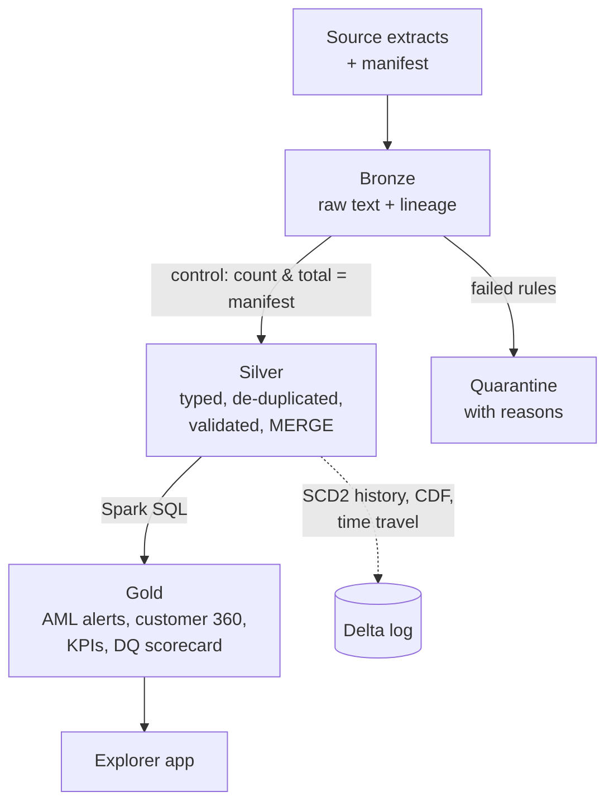
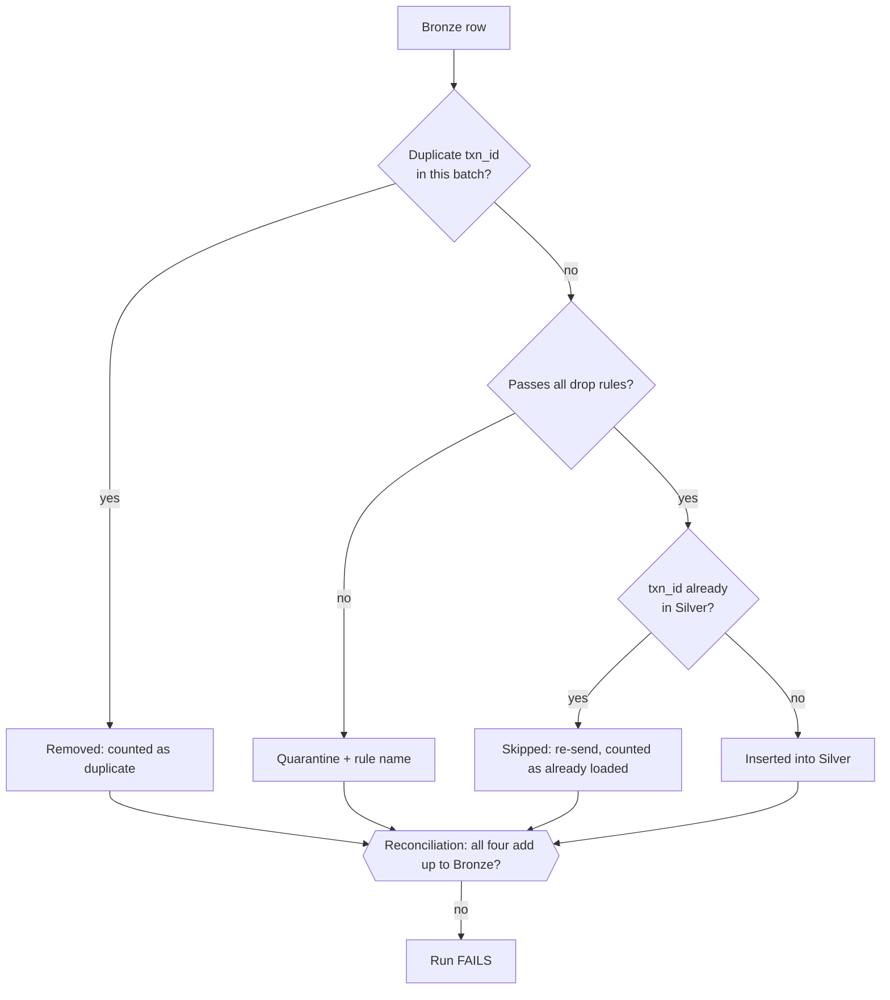
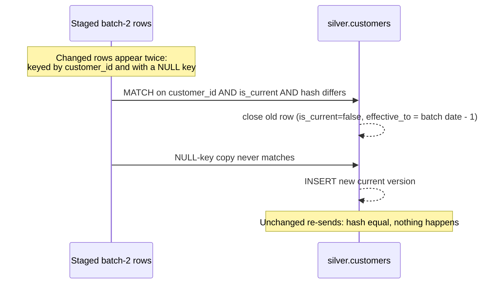

# Interview Pack: Banking Data Engineering Lakehouse

> How to describe it: "I developed this independent project using AI-assisted development tools. I defined the data model, the data-quality rules and the controls from my banking experience. I directed the AI tools that wrote the code, reviewed what they produced, and tested and validated the results." Do not attribute it to any employer. Do not claim you hand-wrote the code.

---

## 1. The 60-second executive summary

"In a bank, bad data isn't an IT problem. It's a misstated report, a missed AML alert, or a payment counted twice. I built a lakehouse for a fictional bank that takes raw core-banking files and turns them into tables that risk and financial-crime teams can trust. It uses a **Bronze, Silver, Gold** design on **Apache Spark and Delta Lake**. Bronze keeps exactly what the source sent. Silver validates it against 18 data-quality rules, quarantines the bad records with the reason, keeps **full history of customer risk-rating changes**, and makes sure a re-sent payment can never be counted twice. Gold produces **AML alert candidates**, a customer 360 view and KPIs. Like a finance reconciliation, every step must balance: the run **stops** if Bronze doesn't match the source's control totals, or if any record is unaccounted for. I planted known defects and suspicious patterns in the synthetic data. The pipeline found **every one and nothing else**, and 44 automated tests prove it on every code change. The same code runs on my laptop, in CI and on Databricks."

## 2. Business problem and banking use case

- **Users:** data engineering, finance and regulatory reporting, AML/financial-crime operations, and risk MI teams.
- **Pain:** source extracts arrive with missing or malformed values, duplicates and late re-sends. Reports built on them are silently wrong. Customer attributes change, such as a KYC risk rating, and overwriting them destroys the history auditors need. Reconciliation is often manual spreadsheet work.
- **What the lakehouse gives them:**
  - one trusted copy of each entity with documented quality
  - proof that every source record is accounted for
  - point-in-time history
  - business-ready tables for AML triage and management reporting
- **Regulatory angle:** banking data principles (accuracy, completeness, timeliness, adaptability, as in BCBS 239), auditability, data minimisation for privacy, and human review of AML alerts.
- **Why medallion?** Separating raw, validated and business layers means a bug in Gold never forces a reload from source. A data-quality issue can be traced back to the exact file and row.

## 3. Key numbers from the committed run

| Measure | Value |
|---|---|
| Source records landed (2 batches + reference data) | 18,513 |
| Silver transactions | 16,644 |
| Duplicates removed / records quarantined | 33 / 25 |
| DQ checks evaluated / blocking controls passed | 52 / 16 of 16 |
| AML alert candidates (all planted, none false) | 7 (3 structuring, 3 high-risk jurisdiction, 1 rapid movement) |
| SCD2 customer changes captured / unchanged re-sends ignored | 40 / 5 |
| Late re-sent transactions not double-counted | 10 |
| Pipeline time on one machine | about 80 seconds |
| Automated tests (Project 02) / whole repo | 44 / 92 |

## 4. What each technology does (plain English, then technical)

| Technology | Plain English | In this project |
|---|---|---|
| **Apache Spark / PySpark** | An engine that processes big tables in parallel across many machines | Silver logic in the DataFrame API (`silver.py`). Locally `local[2]`; on Databricks, serverless compute |
| **Spark SQL** | SQL that runs on Spark | Every Gold table is one `.sql` file in `lakehouse/sql/gold/` |
| **Delta Lake** | Turns files in storage into reliable database tables | ACID transactions, MERGE, time travel, Change Data Feed, schema enforcement, OPTIMIZE |
| **Medallion architecture** | Raw → cleaned → business-ready layers | Bronze (`bronze.py`), Silver (`silver.py`), Gold (`gold.py`) |
| **MERGE (upsert)** | "Insert if new, update if changed" in one atomic step | SCD2 customers, upsert accounts, insert-only transactions |
| **SCD Type 2** | Keep every version of a record with its valid dates | `effective_from`, `effective_to`, `is_current`, and a `record_hash` to spot real changes |
| **Data-quality expectations** | Rules every record must pass, with what to do if it fails | `dq.py`: SQL expressions with warn, drop or fail, in the same style as Databricks Lakeflow expectations |
| **Quarantine** | A holding pen for bad records, with the reason | `silver.*_quarantine` keeps raw values and `_dq_failed_rules` |
| **Reconciliation controls** | Proof that totals match, like a finance rec | Manifest count and amount checks, the Bronze = outcomes check, Gold = Silver checks |
| **Unity Catalog** | Databricks' governance layer: catalog.schema.table, permissions, lineage | Tables at `workspace.ledgerline_<layer>`, a landing volume, tags and column masks |
| **Lakeflow Jobs** | Databricks' scheduler for multi-step pipelines | `01_create_job.py` builds a 6-task DAG with retries |
| **Time travel** | Read a table as it was at an earlier version | `VERSION AS OF 0` returns the September state |
| **Change Data Feed** | A log of row-level inserts and updates | Shows exactly what batch 2 changed in customers and accounts |
| **OPTIMIZE / Z-ORDER** | Tidy small files and sort data so queries skip what they don't need | Run on Silver transactions and customers after Gold |
| **Streamlit** | Python framework for web apps | 8-tab explorer over the run snapshot |
| **DuckDB** | A tiny in-process SQL engine | Powers the app's read-only SQL console, locked against file access |
| **pytest / Playwright / GitHub Actions** | Automated tests, a robot browser, CI | 44 tests that run the real pipeline, an 8-step browser test, and CI on every push |

## 5. Diagrams

### 5.1 Medallion data flow

### 5.2 What happens to one Bronze transaction

### 5.3 SCD Type 2 MERGE

The full component diagram, data model and controls are in [architecture.md](architecture.md).

## 6. Three-minute demo script

| Time | Do | Say |
|---|---|---|
| 0:00 | Open the app, Overview tab | "This is a lakehouse for a fictional bank, all synthetic. This header shows the exact pipeline run you're looking at: Spark 4.1 and Delta Lake, with 16 out of 16 blocking controls passed." |
| 0:20 | Point at the lineage graph | "Raw files land in Bronze untouched. Silver validates and conforms them, and Gold builds what the business uses. The row counts are real." |
| 0:40 | Point at "Every transaction accounted for" | "This is the control I care most about as a banker. Every Bronze row is either a duplicate, quarantined, an already-loaded re-send, or inserted, and the run stops if it doesn't balance. Batch 2 re-sent 10 September payments, and they weren't counted twice." |
| 1:05 | Data quality tab | "18 rules, each declared once with an action: warn, drop or fail. These are the 25 quarantined records, with the raw values and the rule they broke, so a data steward can fix them at source." |
| 1:35 | AML alerts tab, structuring alert selected | "Gold builds AML alert candidates. This customer made four cash deposits between 9,000 and 9,999 dollars on one day, classic structuring. Red dots are the alert transactions in context. They are candidates for an investigator, never decisions." |
| 2:10 | Customer history tab | "Customer risk ratings change. Instead of overwriting, a Delta MERGE closes the old version and opens a new one. So I can always say what the rating was on the day of a transaction, and the Change Data Feed shows exactly what changed." |
| 2:35 | Delta Lake tab, move slider to v0 | "Time travel: this is the table exactly as it was after the September load. That's how you reproduce a report for an auditor." |
| 2:50 | Close | "The same code runs on Databricks with Unity Catalog and a job DAG, and 44 tests run the real pipeline on every change." |

## 7. Ten-minute demo script

1. **(1 min) Problem framing.** Bad data in banks causes misreporting, missed alerts and double counting. Name the BCBS 239 principles. Explain why history and reconciliation matter.
2. **(1.5 min) Architecture.** Use the How it works tab and the lineage graph. Walk through landing (with a manifest, as real source systems send), Bronze, Silver and Gold. Explain the `TableStore` idea: the same code runs locally and on Databricks.
3. **(1.5 min) Reconciliation and controls.** Show the batch equations. Then explain the failure path: if the manifest says 13,538 rows and 13,537 arrive, Bronze fails and nothing downstream runs. An automated test proves this.
4. **(1.5 min) Data quality.** Show the scorecard, quarantine and warn rules. Explain the fail-safe rule: an invalid KYC rating becomes HIGH rather than being dropped, because losing a customer from monitoring is worse than over-monitoring.
5. **(1.5 min) AML.** Cover the three rules and their SQL (expand the SQL panel), priority logic, the human review status, and data minimisation in Gold.
6. **(1 min) History.** Show SCD2 before and after, the as-of join used in segment KPIs, and the Change Data Feed.
7. **(1 min) Delta internals.** Cover history, MERGE metrics, time travel, OPTIMIZE and Z-ORDER, and schema enforcement.
8. **(0.5 min) SQL console.** Run "cash deposits just under 10,000". Mention that the console is sandboxed.
9. **(0.5 min) Testing and honesty.** 44 tests compare results to the generator's answer key. CI runs the pipeline. Then state what isn't verified yet.

## 8. Code walkthrough (where things are)

| File | What it does | Talking point |
|---|---|---|
| `lakehouse/synthetic.py` | Generates customers, accounts and transactions, plants defects and AML scenarios, writes a manifest | "Random noise is capped below every AML threshold, so only planted scenarios can alert. That makes the test exact." |
| `lakehouse/store.py` | `get_spark()`, `LakehouseConfig`, `TableStore` | "One switch between local Delta paths and Unity Catalog names." |
| `lakehouse/bronze.py` | Reads CSV/JSON as strings, adds lineage, makes the load idempotent, runs the manifest controls | "`_metadata.file_path` gives row-level lineage for free." |
| `lakehouse/dq.py` | `Rule`, `apply_expectations`, `control_check`, and the rule lists | "One pass tags each row with an array of failed rule names. A NULL result counts as a failure." |
| `lakehouse/silver.py` | Typing, de-duplication, PII protection, FX, SCD2/upsert/insert-only MERGEs, reconciliation | "The SCD2 MERGE uses the staged-union pattern with a NULL merge key." |
| `lakehouse/sql/gold/*.sql` | Five Gold tables | "Placeholders like `${silver.transactions}` are resolved per environment." |
| `lakehouse/pipeline.py` | Orchestration, audit logging, OPTIMIZE | "Every step writes to `audit.pipeline_steps` and `audit.dq_results`." |
| `lakehouse/snapshot.py` | Exports a run for the app | "Records run id, engine and versions, so the app never overstates what it shows." |
| `databricks/*.py` | Run-all notebook, job creation with the Databricks SDK, governance SQL | "The notebook authenticates as the user; no tokens anywhere." |
| `explorer.py`, `app.py` | App data layer and UI | "DuckDB with external access disabled and the configuration locked." |
| `tests/` | Generator, controls, end-to-end pipeline, snapshot and app tests | "The tests compare against an answer key, not just 'it ran'." |

## 9. Interview questions and answers

### Architecture and design

1. **Why Bronze, Silver and Gold instead of loading straight into reporting tables?**
   Separation of concerns and recoverability. Bronze is an immutable record of what the source sent. If Silver logic has a bug, I fix it and rebuild from Bronze without asking the source to resend. Gold can change for new business needs without touching validation logic.
   *Follow-up: isn't three copies wasteful?* Storage is cheap compared with a misstatement. Bronze can also have a shorter retention period and stricter access.

2. **Why keep every Bronze column as a string?**
   So ingestion never fails or silently loses data because of a bad value. If `amount` arrives as "abc", Bronze stores "abc". Silver's `try_cast` turns it into NULL and the `amount_present` rule quarantines it, with the raw value kept for the data steward.

3. **What is the `TableStore` and why does it matter?**
   It's the one class that maps (layer, table) to either a local Delta path or a Unity Catalog name. Because of it, the PySpark and SQL are identical in CI and on Databricks. What I test is what I deploy.

4. **How is the pipeline orchestrated?**
   Locally, `Pipeline.run_all()` runs land, reference, then Bronze and Silver for each batch, then Gold, then OPTIMIZE. On Databricks, a Lakeflow Jobs DAG runs the same steps as separate tasks with dependencies and retries, sharing one `run_id`.
   *Follow-up: why split into tasks?* Retries happen per step, failures are easier to see, and a failed Gold step doesn't re-ingest.

5. **How would this change for streaming?**
   Bronze would use Auto Loader (`cloudFiles`) to discover new files incrementally, with checkpointing. Silver's MERGE logic would run in `foreachBatch`, and an `availableNow` trigger keeps it cost-efficient. The DQ rules could move to Lakeflow Declarative Pipelines expectations, which map one-to-one onto my warn/drop/fail actions.

### Data quality and controls

6. **How do your data-quality rules work?**
   Each rule is a SQL boolean expression plus an action. In one pass, every row gets an array of the rule names it failed. Rows failing a drop rule go to quarantine, warn rules only flag the row, and fail rules stop the run. Metrics per rule are written to `audit.dq_results`, which feeds the Gold scorecard.

7. **Why does a NULL count as a failure?**
   In SQL, `amount > 0` is NULL when the amount is missing, and a naive filter would quietly let it through or drop it without counting. I wrap every rule in `coalesce(expr, false)`, so missing data is always counted and explained.

8. **What's the difference between your DQ rules and your controls?**
   Rules judge individual records. Controls judge the whole load: did we receive what the source said it sent, and is every record accounted for? Controls are blocking because a control failure means the numbers can't be trusted at all.

9. **Walk me through the reconciliation.**
   For each batch: Bronze rows = duplicates removed + quarantined + already loaded + inserted. For batch 1 that's 13,537 = 25 + 19 + 0 + 13,493. Gold then has to add back to Silver in both count and USD value. If any equation breaks, the step is logged FAILED and the run stops.

10. **Why default an invalid KYC risk rating to HIGH instead of quarantining the customer?**
    Quarantining the customer would orphan their accounts and transactions, which drops them out of AML monitoring. That's the worst outcome. Treating the rating as HIGH until a data steward fixes it is fail-safe: over-monitoring is recoverable, under-monitoring isn't. I found this in testing: one bad rating cascaded into 2 quarantined accounts and 26 quarantined transactions across both batches.

11. **How do you know the pipeline catches the right records and not just some records?**
    The generator keeps an answer key of every planted defect, duplicate, re-send, SCD2 change and AML scenario. Tests assert that the quarantine per rule equals the answer key exactly, and that the alerts per rule equal the planted customers exactly.

12. **What happens to quarantined data?**
    It stays in `*_quarantine` with the raw values, batch id and failed rules, ready for a data steward. It is replaced per batch on re-runs, so it never duplicates. In production I'd add a remediation workflow and ageing metrics, which feeds naturally into Project 04's DQ dashboard.

### Delta Lake

13. **What does Delta Lake add on top of Parquet files?**
    A transaction log. That gives ACID commits, MERGE/UPDATE/DELETE, schema enforcement, time travel, Change Data Feed and file-layout optimisation. Plain Parquet has none of these, so two writers or a failed job can leave a table half-written.

14. **Explain your transaction MERGE.**
    `MERGE INTO silver.transactions t USING batch s ON t.txn_id = s.txn_id WHEN NOT MATCHED THEN INSERT *`. Because there's no WHEN MATCHED clause, an existing transaction is never touched. In batch 2, ten September transactions were re-sent; the MERGE metrics show 3,151 inserted, and the 10 re-sends were correctly skipped.

15. **Explain your SCD Type 2 MERGE.**
    I stage the batch twice for changed customers: once keyed by `customer_id` and once with a NULL key. Matching rows whose hash differs get closed: `is_current = false` and `effective_to` set to the day before. The NULL-key copy can't match, so it's inserted as the new current version. New customers are inserted directly. Unchanged re-sends have the same hash, so nothing happens. All of this is one atomic commit.

16. **Why use a hash for change detection?**
    Comparing five attributes with null-safe logic is error-prone. A SHA-256 of the tracked attributes makes "did anything change?" a single comparison. Only tracked attributes go into the hash, so a change to, say, an e-mail typo doesn't create a new risk-history version.

17. **How does time travel help a bank?**
    Reproducibility. If a regulator asks why a report showed X on a given date, I can query the table `VERSION AS OF` that run and get identical results. It also enables rollback after a bad load with `RESTORE`.

18. **What is Change Data Feed and where would you use it?**
    It records row-level inserts and updates (with before and after images) per commit. Here it shows exactly which customers changed in batch 2. At scale, Gold would read only those changes instead of recomputing everything.

19. **What do OPTIMIZE and Z-ORDER do?**
    OPTIMIZE compacts many small files into fewer large ones. Z-ORDER co-locates rows with similar `customer_id` and `txn_date`, so file-level statistics let queries skip most files. Row counts don't change, only the layout. On newer Databricks runtimes I'd consider liquid clustering instead.

20. **What is schema enforcement? Show me it working.**
    Delta rejects a write whose schema doesn't match the table. A test appends a DataFrame where `amount_usd` is a string, and the write fails. Schema changes have to be deliberate (`mergeSchema`), not accidental.

### Spark

21. **Why use `try_cast` instead of `cast`?**
    Spark 4 runs in ANSI mode, so `cast('' AS decimal)` throws and kills the job. `try_cast` returns NULL, and the DQ rules then quarantine the row with a reason. One bad record shouldn't stop 13,000 good ones. I hit exactly this error during the build.

22. **How do you de-duplicate?**
    A window `row_number()` partitioned by the business key, ordered by `_ingested_at` descending, keeping row 1. That handles exact re-sends within a batch. Re-sends across batches are handled by the insert-only MERGE.

23. **Why did you avoid `cache()` on Databricks?**
    Serverless compute doesn't support the caching APIs. Locally I cache the tagged DataFrame because it's used for both metrics and the split. On Databricks the code skips that line. It's a small example of designing for the target platform.

24. **How do you convert currencies?**
    I join each transaction to the daily FX table on (transaction date, currency) and compute `round(amount * usd_rate, 2)`. A missing rate is a drop rule, because a wrong USD amount is worse than a missing one. A test recomputes every converted amount independently.

25. **How would this scale to billions of rows?**
    Partition or cluster Silver by date. Make Bronze incremental with Auto Loader, make Gold incremental from the Change Data Feed, and avoid driver-side `count()` calls by reading MERGE metrics from the Delta log, which I already do for inserts. Run on autoscaling job compute and monitor skew in joins (for example, a few huge corporate customers).

### Databricks and governance

26. **What does Unity Catalog give you here?**
    A three-level namespace (`workspace.ledgerline_silver.customers`), centralised permissions, automatic table-level lineage from the pipeline's reads and writes, tags for classification, and column masks. The governance notebook hides customer names from anyone outside a KYC analyst group.

27. **How do the notebooks find your Python code?**
    The repo is cloned as a Git folder. The notebook adds the project folder to `sys.path` and imports the same `lakehouse` package the tests use. No code is copied into notebooks.

28. **How does the job authenticate? Where are the secrets?**
    There are none. `WorkspaceClient()` inside a notebook uses the signed-in user's identity. In production I'd run jobs as a service principal with least privilege, and keep any external credentials in Databricks secret scopes.

29. **What would you monitor in production?**
    Step duration and status from `audit.pipeline_steps`, DQ pass rates and trends from `dq_results`, quarantine ageing, reconciliation failures, alert volumes per rule, and freshness (business date vs load time). Alert on any control failure.

### AML and business

30. **Explain your three AML rules.**
    *Structuring:* three or more cash deposits between 9,000 and 9,999.99 USD on the same day. *High-risk jurisdiction:* wires of 10,000 USD or more with a HIGH-tier country. *Rapid movement:* an inbound wire of 50,000 or more with at least 90% wired out within 48 hours. Thresholds are illustrative.

31. **Why are alerts "candidates" and not decisions?**
    Rules produce false positives, and filing or closing an AML case is a regulated judgement. Every alert starts as PENDING_REVIEW for a human investigator, with its rationale and transaction ids. Project 03 builds that human-in-the-loop workflow.

32. **How did you prevent false positives in your test data?**
    The generator caps random amounts below every threshold (in USD terms, after FX), so only planted scenarios can trigger an alert. That makes "found exactly 7, no extras" a meaningful test, not luck.

33. **How do you protect personal data?**
    By layer. Bronze is a restricted evidence copy. Silver hashes the e-mail and masks the phone. Gold has no names, contact details or full date of birth (only birth year). Unity Catalog column masks protect names. Everything is synthetic anyway, and high-risk countries are fictional codes.

34. **Why does segment reporting use an "as-of" join?**
    A customer who moved from Retail to Premier in October should count as Retail for September. Joining transactions to the customer version whose effective dates cover the transaction date gets this right. A control proves every transaction finds exactly one version.

### Testing, delivery and your role

35. **How did you test it?**
    44 automated tests. Generator tests check reproducibility and manifest accuracy. Unit tests cover the DQ engine and blocking controls (including a tampered manifest that must fail). End-to-end tests run both batches through real Spark and Delta and compare against the answer key. Other tests cover idempotent re-runs, time travel, the Change Data Feed, schema enforcement, snapshot reproducibility and the SQL console sandbox. An 8-step Playwright browser test clicks through the app. CI installs Java and runs the pipeline on every push.

36. **What does "idempotent" mean here and how do you prove it?**
    Running the same batch twice leaves everything unchanged. Bronze skips a batch it already holds, the MERGEs don't re-insert, and quarantine is replaced per batch. A test re-runs batch 2 and asserts every table count is identical.

37. **What's AI-generated and what's yours?**
    The code was written by AI tools under my direction. I defined the use case, the entities, the defects and AML scenarios to plant, the controls (reconciliation to manifest, fail-safe risk rating), and the acceptance criteria (exact match to the answer key, idempotency). I reviewed outputs, ran and checked the tests and app, and made the design calls, for example quarantine vs fail-safe and the snapshot approach for hosting.

38. **What doesn't work yet, or what would you do next?**
    It hasn't been run on Databricks yet; it needs my Free Edition workspace. The hosted app shows a snapshot rather than live Spark. Next steps: Auto Loader ingestion, incremental Gold from the Change Data Feed, Lakeflow Declarative Pipelines expectations, and a DQ trends dashboard (Project 04).

## 10. Failure cases you can demonstrate or explain

| Scenario | What happens | Evidence |
|---|---|---|
| Source says 13,538 rows, 13,537 arrive | Bronze control fails, step logged FAILED, run stops | `test_manifest_mismatch_blocks_bronze_and_is_logged` |
| Malformed amount or timestamp | `try_cast` gives NULL, record quarantined with rule name | Quarantine explorer, `test_quarantine_catches_exactly_the_planted_defects` |
| Batch re-run after a crash | Nothing duplicated | `test_rerunning_a_batch_changes_nothing` |
| Payment re-sent a week later | Skipped by insert-only MERGE | `test_silver_transactions_are_unique_and_resends_not_double_counted` |
| Upstream schema drift | Delta rejects the write | `test_schema_enforcement_rejects_a_bad_append` |
| SQL console abuse (file read, DROP, COPY) | Blocked | `test_console_blocks_writes_and_file_access` |

## 11. Resume bullets (accurate and independent)

- Designed and delivered (with AI-assisted development) a Databricks-style medallion lakehouse on Apache Spark 4 and Delta Lake for a synthetic bank. It processes 18.5k source records across two batches through Bronze, Silver and Gold, with 18 declarative data-quality rules and 16 blocking reconciliation controls.
- Implemented SCD Type 2 customer history, idempotent insert-only MERGEs that prevent double-counting of re-sent payments, Change Data Feed and time travel. The pipeline is validated by 44 automated tests that match an answer key of planted defects and AML scenarios exactly.
- Built rule-based AML alert candidates (structuring, high-risk jurisdiction, rapid movement) for human review, plus a Streamlit explorer with lineage, reconciliation, alert drill-down and a sandboxed SQL console. Packaged Unity Catalog governance and a Lakeflow Jobs DAG for Databricks.

*Add after the Databricks run is verified:* "Deployed and ran on Databricks Free Edition with Unity Catalog and a 6-task serverless job."

## 12. Your role (say this plainly)

"I acted as product owner, data architect and test lead. I wrote the requirements: what a bank needs from this data, which defects are realistic, which controls a reviewer would expect, and how alerts must stay human-reviewed. I directed AI coding tools to implement them, reviewed the code and outputs, and insisted on tests that prove exact results. I validated the app myself and decided the trade-offs, for example that an invalid risk rating should default to HIGH rather than drop the customer. I can walk through every module and explain every design choice."

## 13. Certification tie-in (Databricks Data Engineer Associate)

This project exercises these exam topics:

- medallion architecture
- Delta Lake (MERGE, time travel, OPTIMIZE/Z-ORDER, schema enforcement, Change Data Feed)
- Spark SQL and the PySpark DataFrame API
- data-quality expectations
- Unity Catalog objects (catalogs, schemas, volumes, tags, masks)
- Lakeflow Jobs (task dependencies, retries, parameters)

Use the Q&A above as revision prompts. Auto Loader and Lakeflow Declarative Pipelines are described here but not implemented, so study them separately.
