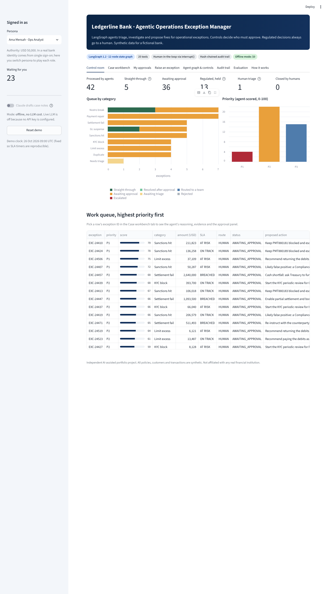

# 03 · Agentic AI Operations Exception Manager

A **LangGraph** multi-step agent that works a bank operations exception queue for a **fictional bank (Ledgerline Bank)**: it triages each exception, investigates it with tools against core banking data, scores its priority, proposes one fix, and then hands it to plain-Python **controls** that decide who must approve. Regulated decisions (sanctions, KYC, credit) are **never** automated. Approvals use LangGraph's `interrupt()` so a case can pause for a human and resume later, with maker-checker and segregation of duties enforced, and every step lands in a **hash-chained audit trail**.

> Independent, AI-assisted portfolio project. All data is synthetic. Not affiliated with any real institution.



## What it does

| Capability | Where |
|---|---|
| Synthetic core banking: customers, accounts with valid IBANs, payments, SSIs, BIC directory, nostro ledger and statement, trades, GL suspense, a fictional sanctions list; a 42-item exception queue across 8 categories with hand-written acceptance criteria | `opsagent/data.py` |
| 12-node LangGraph `StateGraph` with conditional routing, checkpointer and two human-in-the-loop `interrupt()` points | `opsagent/graph.py` |
| Triage agent: TF-IDF + logistic regression with per-prediction explanation; below 55% confidence it asks a human | `opsagent/triage.py` |
| 16 read tools (IBAN mod-97, BIC lookup, SSI master, fuzzy sanctions screening with DOB/country, recon matching, penalty estimate, …) and 9 idempotent action tools | `opsagent/tools.py` |
| 8 investigation and resolution playbooks, each finding tied to the tool that produced it | `opsagent/playbooks.py` |
| Controls: explainable 0-100 priority score, straight-through rules, delegated-authority matrix, four-eyes, segregation of duties, final `authorise()` before any action | `opsagent/policy.py` |
| Shared guardrails (PII redaction, prompt-injection detection) and hash-chained audit log | `portfolio_core/` |
| Optional Claude case notes (never chooses route or action), with a template fallback | `opsagent/manager.py` |
| Evaluation: scenario acceptance, text-only robustness, 300-case control fuzzing | `opsagent/evaluation.py`, `evaluate.py` |
| Streamlit app: control room, case workbench with live graph path, approvals inbox, raise-a-ticket, controls, audit trail, evaluation | `app.py` |

## Verified results (this build)

| Check | Result |
|---|---|
| Scenario acceptance (42 cases) | Route accuracy 100%, triage 100%, sanctions view 100%, duplicate verdict 100%, regulated cases with specialist sign-off 100%, regulated cases auto-executed **0**, injection tickets contained 100% |
| Text-only robustness (codes removed) | Triage 81%; all 8 misses went to human triage, **0** went to a wrong category |
| Control fuzzing | 300 mutated exceptions plus 280 approval attempts by unauthorised people: **0** control violations; audit chain intact |
| Straight-through rate | 5 of 42 (12%): only low-value, reversible, non-regulated recon and suspense items |
| Automated tests (`pytest`) | 50 passed for this project, including headless Streamlit `AppTest` runs |
| Browser test (Playwright, 10 steps against the running app) | All passed; screenshots in `docs/screenshots/` |
| Hosted URL | Not yet deployed (see below) |
| Live Claude case notes | Built and unit-tested with a fake client; **not run against the real API** (needs spend approval) |

Full report: [docs/evaluation/eval_report.md](docs/evaluation/eval_report.md).

## Run it

```bash
pip install -r requirements.txt
streamlit run projects/p3_exception_manager/app.py
python projects/p3_exception_manager/evaluate.py      # evaluation report
pytest projects/p3_exception_manager                  # tests
node scripts/e2e_smoke_p3.js http://localhost:8501    # browser test (needs Playwright)
```

## Documents

- [Architecture](docs/architecture.md)
- [Interview pack](docs/interview_pack.md) and [PDF](docs/Ledgerline_Exception_Manager_Interview_Pack.pdf)
- [Screenshots](docs/screenshots/)
