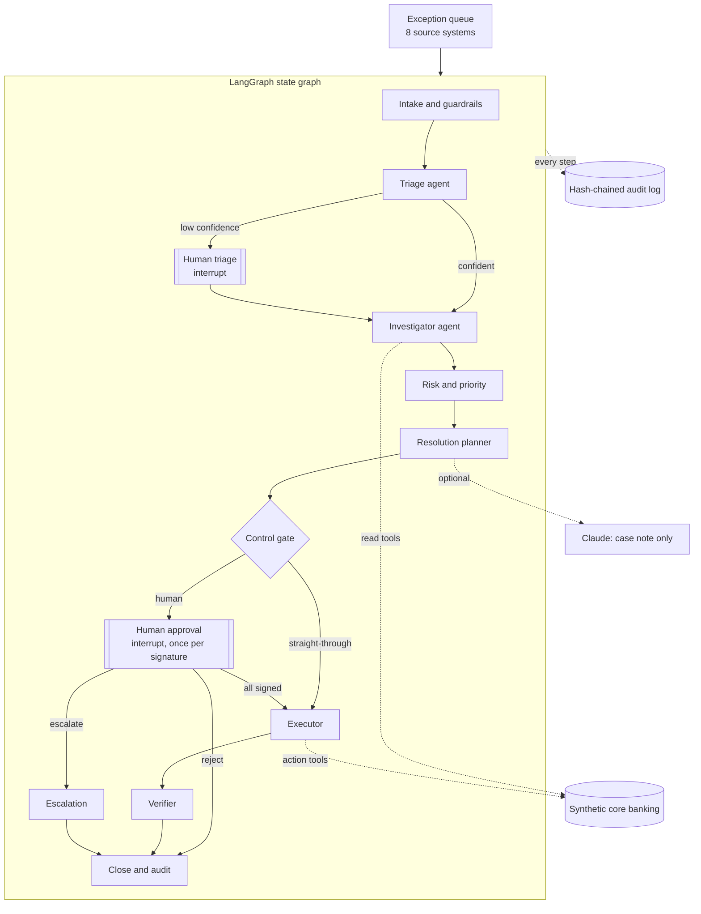
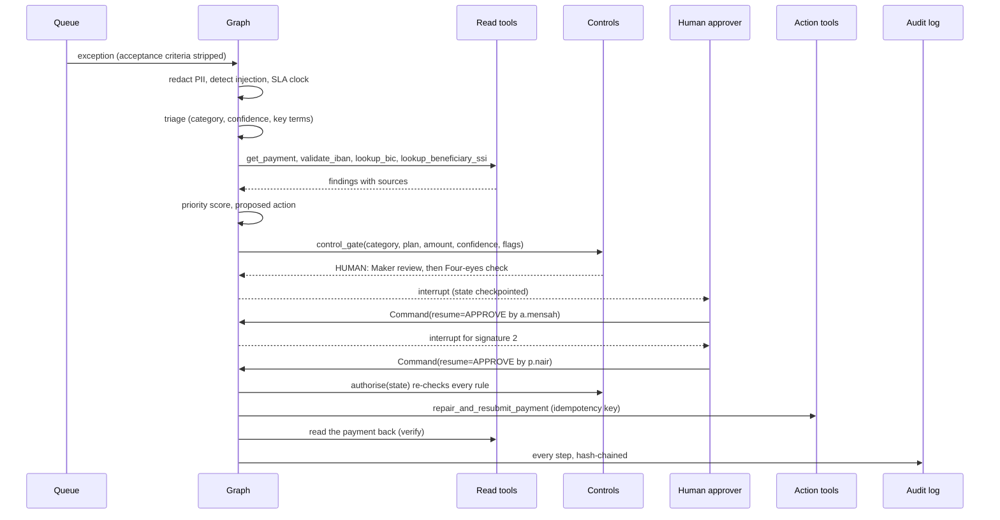

# Architecture: Agentic AI Operations Exception Manager

## 1. Context

Operations teams at a bank clear exceptions every day: payments rejected by the receiving bank, nostro reconciliation breaks, sanctions screening hits, payments blocked by lapsed KYC, failed securities settlements, aged suspense items and overdraft excesses. Most of the effort is gathering evidence from several systems; most of the risk is in the decision and in proving who authorised it.

This project automates the evidence-gathering and the proposal, and keeps the decision with the right human. The design principle: **the agent proposes, controls decide, humans approve, and everything is logged.**

## 2. Component view

| Component | Technology | File |
|---|---|---|
| Workflow engine | LangGraph 1.2 `StateGraph`, `InMemorySaver` checkpointer, `interrupt()` / `Command(resume=…)` | `opsagent/graph.py` |
| Service layer (one thread per exception) | Python | `opsagent/manager.py` |
| Triage model | scikit-learn TF-IDF (1-2 grams) + logistic regression | `opsagent/triage.py` |
| Tools | Python functions with a registry, call log, idempotency ledger | `opsagent/tools.py` |
| Playbooks | Deterministic Python per category | `opsagent/playbooks.py` |
| Controls | Plain Python rules, no model | `opsagent/policy.py` |
| Guardrails and audit | Shared `portfolio_core.guardrails` and `portfolio_core.audit` (SQLite, SHA-256 chain) | `portfolio_core/` |
| LLM (optional) | Claude via the Anthropic SDK, behind `portfolio_core.llm` | `opsagent/manager.py` |
| UI | Streamlit, Altair, Graphviz | `app.py` |

## 3. One exception, step by step

## 4. The controls

| Rule | Setting |
|---|---|
| Regulated categories, never automated | Sanctions hit → Compliance Officer; KYC block → Compliance Officer; Limit excess → Credit Officer |
| Straight-through processing | Only nostro breaks and GL suspense, ≤ USD 10,000, playbook says eligible (exact timing-difference match, or a unique reference match under 30 days old), triage confidence ≥ 0.80, no guardrail flags, not human-triaged |
| Four-eyes | Above USD 50,000, a second approver whose authority covers the amount (Ops Supervisor up to USD 1m, Head of Operations above). Opening a work item needs one signature |
| Segregation of duties | Every signature from a different person; the submitter can never approve |
| Defence in depth | `authorise()` re-runs the rules inside the executor, immediately before any action tool |
| Tool separation | Agents can call only read tools; only the executor may call action tools, each with an idempotency key |
| Prompt injection | Ticket text is data. Instruction-like text is flagged, the case is forced to human review and the flag raises its priority |
| PII | Free text is redacted before triage, before any LLM call and before audit logging |

## 5. Priority score (0-100)

| Component | Points | Logic |
|---|---|---|
| Financial exposure | 0-35 | log scale of the USD amount; USD 10m scores full marks |
| SLA urgency | 0-25 | breached 25, ≤1h 22, ≤4h 16, ≤12h 10, else 4 |
| Regulatory | 0-20 | 20 for regulated categories |
| Customer tier | 0-10 | Platinum 10, Gold 6, other 3 |
| Ageing / penalties / flags | 0-10 | suspense > 30 days, settlement penalties accruing, guardrail flag |

Bands: P1 ≥ 70, P2 ≥ 50, P3 ≥ 30, P4 below.

## 6. Why LangGraph here

The brief asks to use agent frameworks only where they add real value. Here they do: the workflow has **branches** (straight-through vs human, triage vs not), a **loop** (one interrupt per required signature, re-asking after a refused approver), and **pauses** that must survive between requests (a case waits for a Compliance Officer while others continue). LangGraph's checkpointed state and `interrupt()` give that without hand-writing a state machine. Each exception is one LangGraph thread (`thread_id` = exception id).

## 7. Where an LLM is (and is not) used

- **Not used for decisions.** Classification is a small, explainable scikit-learn model; investigation, planning and routing are deterministic. This makes the behaviour testable and explainable to audit.
- **Optional Claude case note.** With an API key and the toggle on, Claude writes the case note from the redacted ticket and the evidence. The system prompt forbids inventing facts and states that the route is fixed; the ticket is wrapped as data. If the call fails, a template note is used and the case continues. This path is unit-tested with a fake client and has not been run against the live API.

## 8. Security, privacy and cost

- Synthetic data only; the sanctions list and its programmes are fictional.
- No secrets in code; the API key would live in Streamlit secrets.
- Each browser session gets its own bank, graph, checkpointer and audit log in memory.
- Cost: $0 in the default offline mode.

## 9. Trade-offs and limitations

- The checkpointer and audit log are in memory per session. Production would use a durable checkpointer (for example Postgres) and a write-once audit store.
- Personas are chosen from a dropdown for the demo; production identity would come from single sign-on and an entitlement system.
- The triage model is trained on synthetic history. With source system and reason code it is 100% on the seed queue; on free text alone it is 81%, and every miss falls back to human triage.
- Action tools change an in-memory synthetic bank, not real systems. Penalty rates are illustrative, not regulatory values.
- Fixed demo clock (26 Oct 2026 09:00 UTC) so SLA numbers are reproducible.
