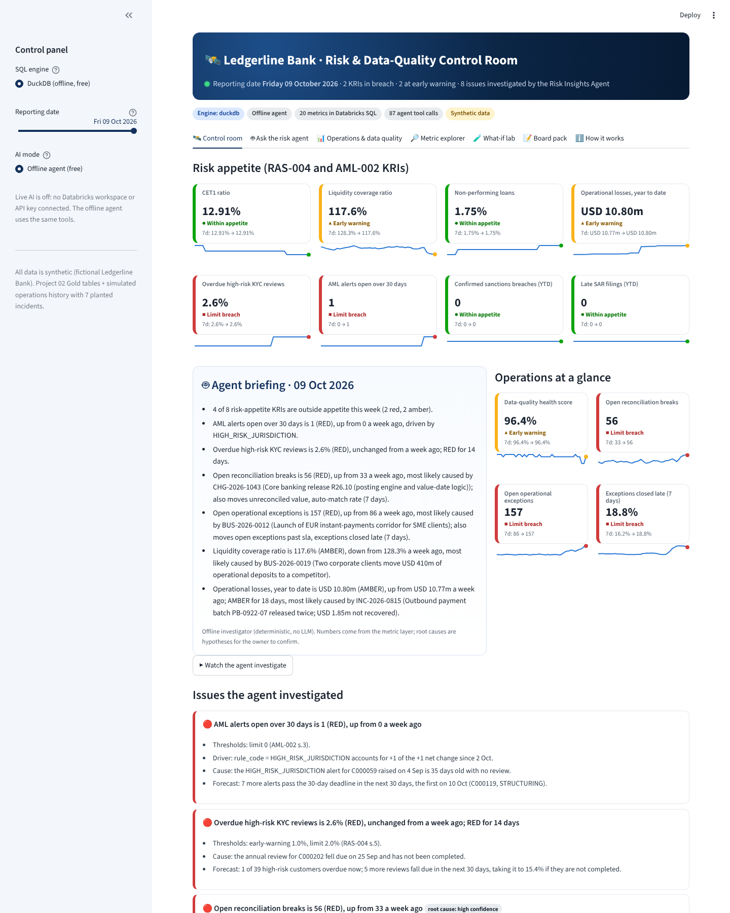

# 04 · AI-Powered Risk & Data-Quality Control Room

A risk and data-quality control room for a **fictional bank (Ledgerline Bank)**. Twenty risk KPIs and KRIs are defined once, as **Databricks SQL** views over the Project 02 lakehouse plus an operations history. A **Risk Insights Agent** then works like a junior risk analyst. Every morning it scans the metrics and investigates each break: what moved, which reconciliation, team or rule drove it, when it started, and which release, incident or business change probably caused it. It forecasts when a KRI will cross its limit and drafts the weekly board pack, which a named risk owner must approve. Managers can ask it questions in plain English and run what-if scenarios.

> Independent, AI-assisted portfolio project. All data is synthetic. Not affiliated with any real institution.



## What it does

| Capability | Where |
|---|---|
| 20 metrics (8 board KRIs, 12 operational KPIs) with owners, thresholds and RAS-004 policy references, defined as a semantic layer | `riskdash/catalog.py` |
| 12 fact views in Databricks SQL. The same SQL runs on DuckDB (translated by sqlglot), on Spark and on a Databricks SQL warehouse | `riskdash/sql/views/`, `riskdash/engine.py` |
| Builds on Project 02 Gold tables (customer 360, AML alert candidates, payment volumes, DQ scorecard) plus a seeded operations history with 7 planted incidents and 6 decoy changes | `riskdash/synthetic.py` |
| **Risk Insights Agent** with 13 read-only tools. It triages, finds the driver (rate-effect decomposition), dates the onset (step or ramp change-point), correlates with the change calendar using lineage, forecasts and recommends RAS-004 actions | `riskdash/agent.py`, `tools.py`, `analytics.py` |
| Forecasts: scheduled facts (KYC due dates, AML 30-day deadlines) or a robust Theil-Sen trend. Five what-if scenarios, each listing its assumptions | `riskdash/scenarios.py` |
| **Ask the risk agent**: free offline Q&A (why, forecast, what-if, list, trend). Optional live **LLM** mode that drives the same tools: a **Databricks foundation model** (free on Free Edition, no API key) or Claude. Every number in an LLM answer is checked against the tool results before it is shown, or the offline answer is kept | `riskdash/chat.py`, `riskdash/llm.py` |
| Board pack with human approval: the reviewer is named, the pack is hashed with SHA-256, and the hash goes in a hash-chained audit log. Exports to HTML and Markdown | `app.py`, `riskdash/report.py` |
| Streamlit control room with 7 tabs. Drill-down from KRI to driver to records, a time machine to replay any reporting date, and both SQL dialects shown for every metric | `app.py`, `riskdash/charts.py` |
| Databricks notebook: writes the risk mart and views to Unity Catalog, runs the agent on Spark and saves its findings as Delta tables | `databricks/00_build_risk_mart.py`, `riskdash/lakehouse.py` |
| Back-test: replays 50 business days. The agent sees only the data up to each day | `evaluate.py`, `riskdash/evaluation.py` |

## Verified results (this build)

| Check | Result |
|---|---|
| Agent back-test, 50 business days (3 Aug to 9 Oct 2026) | **7 of 7** planted incidents found with the right cause, **0** wrong root causes on any day. Median detection lag: 0 business days; the longest was 2 ([report](docs/evaluation/backtest_report.md)). Decoy releases are never blamed |
| Same SQL on two engines | All 12 views return identical rows on DuckDB and Apache Spark 4.1.3 (automated test) |
| Databricks notebook path | Run end to end on local Spark: it writes the tables and views, then runs the agent. The briefing is **identical** to the offline one (automated test) |
| Automated tests (`pytest`) | 85 for this project (191 in the repo), including a Streamlit AppTest, a fake Databricks workspace and fake Databricks AI and Claude clients |
| Browser test (Playwright, 9 steps against the running app) | All passed; screenshots in `docs/screenshots/` |
| **Databricks Free Edition run** | **Not yet run by Nipun.** Steps below |
| **Live LLM mode** | **Not yet run against a real model.** The Databricks foundation-model path (endpoint discovery, tool loop, grounding check and fallback) is tested against a fake workspace, and the notebook's fallback was run locally. Which endpoints Free Edition offers is not confirmed until Nipun runs the notebook. Claude is optional and needs an API key and spend approval |
| **Public hosted URL** | **Not yet deployed** |

Honest caveat: the incidents were planted in synthetic data, and the agent's rules were written with banking judgement, not trained. The back-test shows the investigation mechanics work end to end. It does not measure real-world accuracy.

## Run it

From the repository root:

```bash
pip install -r requirements-dev.txt
streamlit run projects/p4_risk_dashboard/app.py       # the control room (no Java needed)
python projects/p4_risk_dashboard/evaluate.py         # agent back-test
pytest projects/p4_risk_dashboard                      # tests (Spark tests need Java 17+)
```

### On Databricks Free Edition

1. Run Project 02's `projects/p2_lakehouse/databricks/00_run_pipeline` first. It creates `workspace.ledgerline_gold`.
2. Open `projects/p4_risk_dashboard/databricks/00_build_risk_mart` and click **Run all** (serverless; a few minutes). If you skipped step 1, set the `gold_source` widget to `snapshot`. Step 7 asks the agent's example questions through a Databricks foundation model using the notebook's own credentials, and saves the answers and grounding results to `agent_llm_answers`.
3. Optional: to make the app read live from Databricks, add `DATABRICKS_SERVER_HOSTNAME`, `DATABRICKS_HTTP_PATH` and `DATABRICKS_TOKEN` to the app's Streamlit secrets. The sidebar then offers **Databricks SQL (live)** and **Databricks AI (live)**. Never paste these values in chat.

## Documentation

- [Architecture, diagrams, agent design, controls, security, cost and limitations](docs/architecture.md)
- [Interview pack: summary, demo scripts, 36 Q&A, code walkthrough, resume lines, your role](docs/interview_pack.md)
