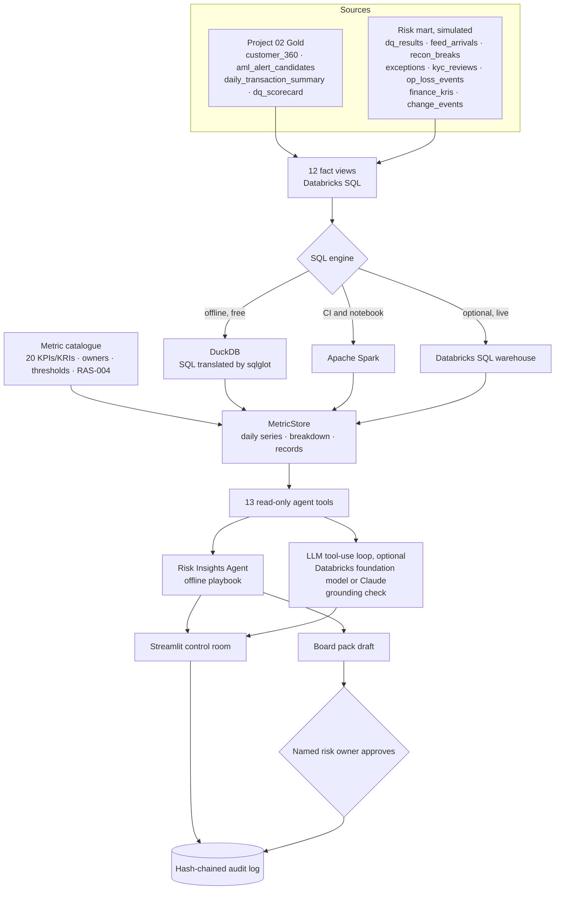
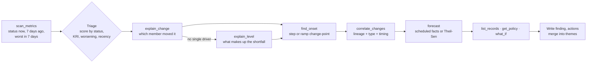

# Architecture: AI-Powered Risk & Data-Quality Control Room

## 1. Context

Risk MI in a bank usually arrives as a static pack. A KRI turns red and someone spends a day finding out why: which desk, which system, since when, and whether a release caused it. This project automates that first day of work, transparently. Every metric is defined once in Databricks SQL. A deterministic agent investigates every break with the same tools a human analyst would use, and states its evidence and confidence. A human approves anything that goes to the board.

Ledgerline Bank is fictional and every record is synthetic. The Project 02 Gold tables are real pipeline output (from synthetic sources). The operations history (data-quality runs, feeds, reconciliations, exceptions, KYC reviews, losses, KRIs, change calendar) is simulated with a fixed seed. It contains 7 planted incidents and 6 decoy changes, so the agent can be tested against an answer key.

## 2. Component view

## 3. The semantic metric layer

Each metric is a small, reviewable definition in `riskdash/catalog.py`:

| Field | Example (`RECON_OPEN_BREAKS`) |
|---|---|
| Fact view | `fv_recon_open_breaks` (one row per open break per day) |
| Formula | `SUM(open_breaks)`; ratios are `SUM(numerator) / SUM(denominator) × scale` |
| Dimensions | `recon_id`, `break_type`, `owner_team`, `age_bucket` |
| Direction and thresholds | lower is better · early warning 30 · limit 45 |
| Owner and policy | Head of Reconciliations · RAS-004 for KRIs |
| Records | the break IDs and the columns shown in drill-down |

Because every metric is a sum (or a ratio of sums) over rows that carry their dimensions, the same definition gives the headline number, the breakdown by any dimension, the drill-down records and the daily history. The RAG status follows RAS-004. If higher is better, a value below the limit is red and below the early-warning trigger is amber. If lower is better, a value above the limit is red and at or above the trigger is amber. Zero-tolerance KRIs have a limit of 0 and no amber.

### The 20 metrics

| Domain | Metrics |
|---|---|
| Capital and liquidity | CET1 ratio (12.5 / 11.5), LCR (120 / 110) |
| Credit risk | Non-performing loans (2.0 / 2.5) |
| Operational risk | Operational losses YTD (USD 10m / 15m) |
| Financial crime and compliance | Overdue high-risk KYC reviews (1% / 2%), AML alerts open over 30 days (0), sanctions breaches (0), late SARs (0) |
| Data quality | DQ health score (98 / 95), DQ rules breached (1 / 2), feeds on time (95 / 90) |
| Reconciliations | Open breaks (30 / 45), unreconciled value (USD 2m / 4m), breaks over 5 days (8 / 15), auto-match rate (98 / 97) |
| Operations and SLAs | Open exceptions (60 / 100), past SLA (15 / 40), closed late (5% / 10%) |
| Business activity (context) | AML alerts pending, payment volume |

## 4. One SQL, three engines

View SQL refers to tables as `${mart.table}` and `${gold.table}`. Each engine fills in its own names and runs the SQL:

| Engine | Table names | Dialect |
|---|---|---|
| `DuckDBEngine` (default) | `ledgerline_riskmart.x`, `ledgerline_gold.x` in memory | Databricks SQL translated to DuckDB by sqlglot. It is locked: no file or network access, and the configuration cannot be changed |
| `SparkEngine` | temp views in CI, or `workspace.ledgerline_riskmart.x` on Databricks | unchanged |
| `DatabricksSQLEngine` | `<catalog>.ledgerline_riskmart.x` through `databricks-sql-connector` | unchanged |

A test runs all 12 views on DuckDB and on Spark and requires identical rows. A second test runs the notebook path on local Spark. It writes the tables and views, rebuilds the MetricStore from them and runs the agent. The briefing must be **identical** to the offline briefing.

## 5. The Risk Insights Agent

| Step | How it works |
|---|---|
| Triage | Red scores 80 and amber 40. A metric that was worse earlier in the week but has recovered is a "transient" finding (60 or 30). A KRI adds 20, a status that got worse in the week adds 15, and a new status adds 5. The top 16 are investigated |
| Driver | For a ratio, each member's contribution is its **rate effect**: weight × (rate now − rate before). Mix shifts therefore don't masquerade as drivers. A member must explain at least 40% of a material move. If the metric has been bad for a while with no recent move, `explain_level` finds what makes up the shortfall |
| Onset | Least-squares change-point over 90 days. It compares a level shift (step) with a flat-then-linear (ramp) model and picks the better fit. For exceptions it uses business-day arrivals for the driving team, so weekends don't blur the date |
| Root cause | The candidate window is 5 days before the onset for a step, and 21 days before to 7 days after for a ramp. Each candidate scores +2 if its system feeds the driver (data lineage), +1 if its type usually moves this kind of metric (a release for DQ, a business change for SLAs) and up to +1 for proximity. Confidence is **high** for a lineage match scoring 3 or more, and **medium** for a lineage match below that. Timing alone is **never** reported as a cause |
| Scheduled KRIs | Overdue KYC and AML 30-day alerts are explained by their records (who is overdue, and since when) and forecast from due dates, not from trends |
| Actions | RAS-004 s.6 deadlines: a zero-tolerance breach within 24 hours, a limit breach within 2 business days, an early warning within 5 business days. Metric-specific remediation is added: clear the NOSTRO_EUR breaks, add Payments Ops handlers (sized by the what-if), complete the named reviews |
| Themes | Findings that share a root cause are merged, so one release shows as one issue with its related metrics |

The offline agent is deterministic and costs nothing. The board pack is built only from its findings.

## 6. Conversational Q&A and live LLM mode

- **Offline (default):** regex intent routing (why, forecast, what-if, list, trend, status, summary) and a synonym map to metrics. The answers come from the same tools. A "why" question re-runs the investigation live, so the answer comes with a tool trace.
- **Live LLM (optional):** the 13 tools are offered to a language model, with up to 8 tool rounds. The loop is provider-neutral and has two backends. The first is a **Databricks foundation-model endpoint** (OpenAI-style chat completions with tools at `/serving-endpoints/<name>/invocations`). On Free Edition it is free, and in the notebook it uses the notebook's own credentials. Because available endpoints differ by workspace, it lists them and keeps the first candidate that passes a one-call tool probe. The second is **Claude** through the Anthropic Messages API, if a key is configured. The system prompt requires every number to come from a tool. After the answer, `grounding_check` extracts every number and requires it to match a tool result. Rounding and unit scaling are allowed; dates, IDs and small counts are ignored. An answer that fails the check is **not shown**: the app shows the offline answer and records why in the audit log. The mode appears only when the app owner has configured a key.

## 7. Human in the loop and audit

- The board pack is a **draft** until a named reviewer approves it. The approve button is disabled until a name is entered. Approval records the reviewer, a SHA-256 hash of the exact pack text and the reporting date in a hash-chained audit log (`portfolio_core.audit`). The exported HTML carries the approval stamp.
- Every question, every LLM answer (with its model, grounding result and token counts) and every approval is an audit event. The app shows whether the chain is intact.
- The agent recommends. It never says an action has been taken.

## 8. Databricks deployment

`databricks/00_build_risk_mart.py` runs on serverless compute:

1. Read `workspace.ledgerline_gold` (Project 02). As a fallback it can load the committed snapshot.
2. Generate the risk mart and save 13 Delta tables in `workspace.ledgerline_riskmart`.
3. Create the 12 fact views in Unity Catalog from the same SQL files, with the first SQL comment as the view comment.
4. Run the agent on Spark and save `kri_snapshot` (each metric's value and status for every business day), `agent_findings` and `agent_actions`. These tables are ready for a Databricks SQL dashboard or Genie space.
5. Ask the example questions through a foundation-model endpoint and save the answers, the model used, the grounding result and the token counts to `agent_llm_answers`. If no endpoint with tool calling is available, the offline answers are kept and the notebook says so.

## 9. Security and privacy

- Synthetic data only, and no customer PII beyond synthetic IDs.
- The offline SQL engine cannot read files, reach the network or change its own settings.
- Secrets (Anthropic key, Databricks token) are read only from environment variables or Streamlit secrets. They are never displayed or logged and never committed (`.streamlit/secrets.toml` is git-ignored).
- The LLM sees only tool outputs (aggregates and synthetic record IDs), never raw tables.
- The agent's tools are read-only.

## 10. Cost

| Component | Cost |
|---|---|
| Offline app, agent, tests, CI | Free |
| Streamlit Community Cloud hosting | Free |
| Databricks Free Edition notebook | Free (serverless quota) |
| Live LLM, Databricks foundation model | Free on Databricks Free Edition (within its usage limits) |
| Live LLM, Claude | Paid per token. Rough estimate: 10 to 30k input tokens per question, because tool results are included. Off until the owner adds a key and approves spend |

## 11. Trade-offs and limitations

- **Planted incidents.** The back-test proves the mechanics on a known answer key. It is not evidence of accuracy on real bank data, where lineage metadata and change calendars are messier.
- **Rules, not learning.** Driver, onset and correlation logic is transparent statistics plus banking rules. That is good for explainability and audit; the price is coverage of unusual patterns.
- **Correlation is not causation.** That is why confidence levels exist and why timing-only matches are suppressed.
- **Thresholds are illustrative.** In a real bank they come from the board-approved risk appetite statement.
- **Daily grain.** Intraday liquidity or real-time payments monitoring would need streaming.
- **The offline router is keyword-based.** The live LLM mode handles free-form questions better. Smaller open models may fail the grounding check more often, and the app then shows the offline answer.
