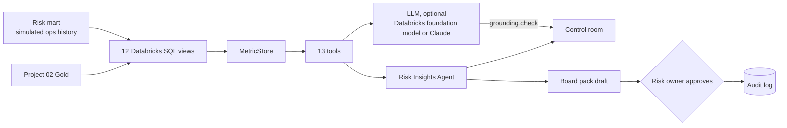
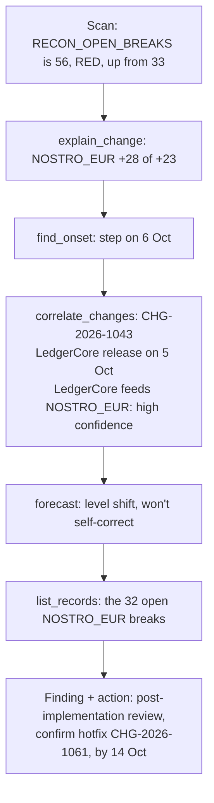
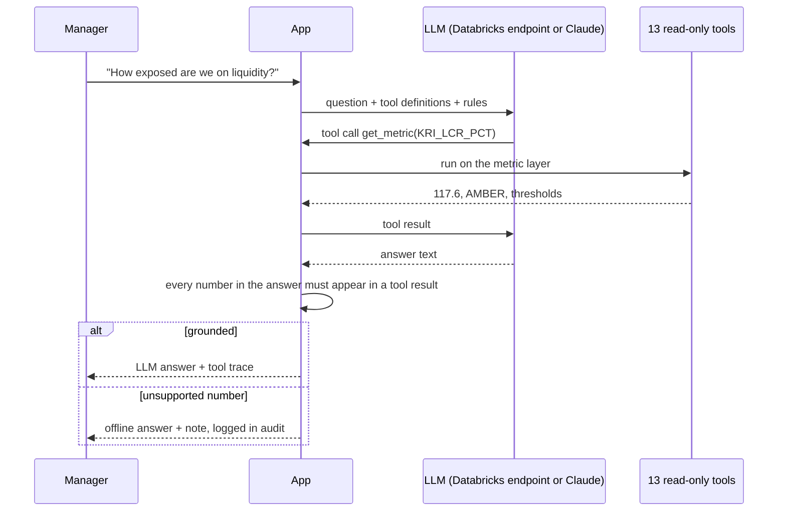

# Interview Pack: AI-Powered Risk & Data-Quality Control Room

> How to describe it: "I developed this independent project using AI-assisted development tools. I defined the risk metrics, the thresholds, the investigation playbook and the controls from my banking experience. I directed the AI tools that wrote the code, reviewed what they produced, and tested and validated the results." Do not attribute it to any employer. Do not claim you hand-wrote the code.

---

## 1. The 60-second executive summary

"When a KRI turns red, a risk team spends the next day answering the same questions. Which desk drove it? Since when? Did a release cause it? How bad will it get? I built an AI control room for a fictional bank that does that first day of work automatically, and shows its evidence. Twenty KPIs and KRIs, from LCR and overdue KYC reviews to reconciliation breaks and data-quality scores, are defined once as **Databricks SQL** views over my Project 02 lakehouse. A **Risk Insights Agent** scans them every day and investigates each break with 13 tools. It finds the driver, dates when the move started, matches it to the IT change and incident calendar using data lineage, forecasts when the KRI will cross its limit, and drafts RAS-004 actions. Managers can ask it questions in plain English or run what-ifs like 'what if another 300 million of deposits leaves'. It also drafts the board pack, which a named risk owner must approve. I planted seven incidents and six decoy releases in the data. Replaying fifty business days, the agent found **all seven with the right cause and never blamed a decoy**."

## 2. Business problem and banking use case

- **Users:** CRO office, risk MI and second-line risk teams, operations heads, data-quality owners, and the board risk committee (as readers of the pack).
- **Pain:**
  - Risk packs are static.
  - Root-cause analysis is manual and slow, and depends on who knows which system feeds which report.
  - Data-quality problems surface as wrong KRIs weeks later.
  - Escalation deadlines from the risk appetite statement get missed.
- **What it gives them:**
  - one governed definition of every metric
  - a daily, explained view of what changed and why
  - forecasts of limit breaches before they happen
  - scenario answers in seconds
  - a board-pack draft with a human sign-off and an audit trail
- **Regulatory angle:**
  - risk data aggregation and reporting (BCBS 239: accuracy, completeness, timeliness, adaptability)
  - risk appetite escalation (RAS-004 in the policy library from Project 01)
  - AML investigation timeliness (AML-002)
  - model and AI governance: transparent logic, confidence levels, human approval and an audit log
- **Why AI here, and why not more of it:** the investigation is a repeatable playbook, which suits an agent with tools. The numbers must be exact and auditable, so the AI never computes or invents a figure. Every number comes from SQL, and the optional LLM is fenced by a grounding check.

## 3. Key numbers from this build

| Measure | Value |
|---|---|
| Metrics / board KRIs / fact views | 20 / 8 / 12 |
| Agent tools | 13, all read-only |
| Tool calls in one daily investigation (9 Oct) | 87, about 2 seconds offline |
| Findings / actions on 9 Oct | 8 issues / 12 actions |
| Planted incidents found in the 50-day back-test | 7 of 7, with the right cause |
| Wrong root causes on any of the 50 days | 0 (6 decoy releases never blamed) |
| Median / longest detection lag | 0 / 2 business days after onset |
| Engines giving identical results | DuckDB and Apache Spark (all 12 views); the agent's briefing is identical on Spark |
| Automated tests (Project 04) / whole repo | 81 / 174 |
| Browser test | 9 steps, all passed |

## 4. What each technology does (plain English, then technical)

| Technology | Plain English | In this project |
|---|---|---|
| **Databricks SQL** | SQL on the Databricks platform, run by a SQL warehouse | The 12 fact views are written in Databricks SQL and created as Unity Catalog views by the notebook. Live mode queries a warehouse |
| **Semantic layer** | One agreed definition per metric | `catalog.py`: numerator, denominator, dimensions, thresholds, owner and policy for each metric |
| **Unity Catalog** | Databricks governance: catalog.schema.table, permissions, lineage | `workspace.ledgerline_riskmart` (risk mart, views, agent outputs) next to `workspace.ledgerline_gold` from Project 02 |
| **Delta Lake** | Reliable tables in cloud storage | The notebook saves the mart, `kri_snapshot`, `agent_findings` and `agent_actions` as Delta tables |
| **DuckDB + sqlglot** | A tiny in-process database, plus a translator between SQL dialects | Offline mode runs the same Databricks SQL, translated automatically. Locked against file and network access |
| **Apache Spark** | Distributed processing engine | CI checks the views give identical rows on Spark; the notebook runs everything on Spark |
| **AI agent with tools** | A program that decides which analysis to run next and calls functions to get facts | `RiskInsightsAgent` follows an investigation playbook over 13 tools and keeps a trace of every call |
| **Change-point detection** | Finding the day a series changed behaviour | Least-squares step vs ramp fit in `analytics.py` |
| **Rate-effect decomposition** | Splitting a ratio's move into "who got worse" vs "mix changed" | `MetricStore.breakdown` for ratio metrics |
| **Theil-Sen trend** | A robust slope that one outlier can't bend | Used to forecast when a KRI crosses its limit |
| **Databricks foundation models** | Large language models hosted in your Databricks workspace | Optional live mode: the model answers free-form questions by calling the same tools. It is free on Free Edition and needs no API key. A grounding check rejects any unsupported number |
| **Claude (Anthropic API)** | A large language model from Anthropic | A second, optional backend for the same tool loop (paid) |
| **Streamlit + Altair** | Python web apps and charts | 7-tab control room with sparklines, heatmaps, trend lines with threshold bands and change markers |
| **Hash-chained audit log** | Each log entry includes the hash of the previous one, so tampering shows | Questions, LLM answers and board-pack approvals |
| **pytest / Playwright / GitHub Actions** | Automated tests, a robot browser, CI | 81 tests, a 9-step browser test, and CI that runs the back-test |

## 5. Diagrams

### 5.1 Data and AI flow

### 5.2 How one break is investigated

### 5.3 Live LLM mode with a grounding check

## 6. Three-minute demo script

| Time | Do | Say |
|---|---|---|
| 0:00 | Open the app, Control room tab | "This is a risk control room for a fictional bank, all synthetic data. Eight board KRIs from the risk appetite statement: two red, two amber. The sparklines show the last six weeks." |
| 0:20 | Point at the agent briefing | "Every morning an AI agent investigates each break. Here it says reconciliation breaks jumped from 33 to 56, most likely because of core banking release R26.10. Liquidity fell because two corporate clients moved 410 million of deposits." |
| 0:45 | Click "Watch the agent investigate" | "This is its actual work: 87 tool calls. Scan, explain the change, find when it started, match it to the change calendar, forecast, pull the records, check the policy. All read-only." |
| 1:10 | Ask tab, "Why did reconciliation breaks go up?" | "I can ask it in plain English. The driver is the EUR nostro reconciliation, plus 28 breaks. The move started on 6 October, a day after the LedgerCore release, which feeds that reconciliation. That is why confidence is high: timing plus lineage. Timing alone is never reported as a cause." |
| 1:40 | Type "What if another USD 300m of deposits leaves?" | "Scenario answers in a second. LCR would fall towards the 110% limit, and it shows its assumptions." |
| 2:00 | Metric explorer, Open reconciliation breaks | "Every number drills down to the records, and here is the SQL. Databricks SQL is the source of truth. Offline, the same SQL is translated to DuckDB automatically." |
| 2:25 | Board pack tab, enter a name, Approve | "The agent drafts the board pack, but it can't publish it. A named risk owner approves, and the exact text is hashed into an audit log." |
| 2:45 | How it works, back-test | "I planted seven incidents and six decoy releases. Replaying fifty days, it found all seven with the right cause and never blamed a decoy. On Databricks, the same notebook writes the findings to Unity Catalog." |

## 7. Ten-minute demo script

1. **(1 min) Problem framing.** Static risk packs, slow root cause, missed escalation deadlines. Name BCBS 239 and the RAS-004 escalation rules.
2. **(1.5 min) Metric layer.** Show the Metric explorer: definition, formula, thresholds, owner and both SQL dialects. Explain "define once, use everywhere": headline, breakdown, drill-down and history all come from one definition.
3. **(1.5 min) The agent's playbook.** Watch the investigation. Explain the triage scoring, rate-effect drivers (mix vs performance), step vs ramp change-points, and lineage scoring with confidence levels.
4. **(1 min) A slow-burn incident.** Ask "Why is the data-quality score amber?" The DQ-KYC-01 address-completeness rule has drifted since mid-August. The agent dates the ramp to 14 August, three days before the onboarding form release on 17 August, and links the two through OnboardIQ lineage.
5. **(1 min) Scheduled KRIs.** Ask "Which high-risk customers are overdue for KYC review?" The answer comes from records and due dates, not trends: one of 39 is overdue, five more fall due within 30 days, which would take the KRI to 15.4%.
6. **(1 min) What-if lab.** Move the Payments Ops handlers slider: 2 are needed just to stop growth, and 3 clear the backlog by 28 October. Show the LCR outflow slider and its headroom.
7. **(1 min) Time machine.** Move the reporting date back to mid-September. The whole page, including the agent, recomputes as of that day, and the October incidents disappear.
8. **(1 min) LLM mode and guardrails.** Explain the tool loop with a Databricks foundation model (free on Free Edition), endpoint discovery, the grounding check and the fallback. Be clear about what has and has not been run against a real model.
9. **(1 min) Databricks and testing.** Cover the notebook (Unity Catalog views, Delta outputs), DuckDB vs Spark parity, the back-test and the 85 tests. State what is not verified yet.

## 8. Code walkthrough (where things are)

| File | What it does | Talking point |
|---|---|---|
| `riskdash/catalog.py` | 20 metric definitions, RAG rules | "A metric is a sum or a ratio of sums over rows that carry their dimensions. That one decision makes drill-down free." |
| `riskdash/sql/views/*.sql` | 12 fact views in Databricks SQL | "`${mart.x}` and `${gold.x}` placeholders are resolved per engine." |
| `riskdash/engine.py` | DuckDB, Spark and Databricks SQL engines | "sqlglot translates Databricks SQL to DuckDB; DuckDB is locked down." |
| `riskdash/metrics.py` | MetricStore: series, snapshots, breakdown, records | "Ratio breakdowns use the rate effect, so a mix shift isn't blamed on a team." |
| `riskdash/analytics.py` | Change-point (step vs ramp) and Theil-Sen | "Small, testable statistics instead of a black box." |
| `riskdash/tools.py` | The 13 tools, lineage map, change correlation | "Lineage +2, change type +1, proximity bonus. Timing alone is dropped." |
| `riskdash/agent.py` | Triage, investigate, write findings and actions, themes | "Deterministic: the same data always gives the same briefing, which auditors like." |
| `riskdash/scenarios.py` | Forecasts and five what-ifs | "Every scenario returns its assumptions." |
| `riskdash/chat.py` | Offline Q&A router | "A why-question re-runs the investigation live, so you see the trace." |
| `riskdash/llm.py` | Provider-neutral tool loop (Databricks foundation model or Claude) and grounding check | "No unsupported number reaches the screen." |
| `riskdash/lakehouse.py`, `databricks/00_build_risk_mart.py` | Unity Catalog build and agent outputs as Delta | "Tested end to end on local Spark: same briefing as offline." |
| `riskdash/evaluation.py`, `evaluate.py` | 50-day back-test | "The agent only sees data up to each day." |
| `app.py` | Streamlit control room | "Tiles, briefing, chat, explorer, what-if, board pack, how it works." |

## 9. Interview questions and answers

### Design and architecture

1. **Why define metrics in a semantic layer instead of in the dashboard?** So that the headline number, the drill-down, the history and the agent all use one definition. In a bank, two versions of "overdue KYC" is a finding from internal audit. The catalogue also carries the owner, the thresholds and the policy reference.
2. **Why Databricks SQL views rather than Python calculations?** The calculation logic should live where the data lives and be readable by risk analysts and auditors. The views run unchanged on a SQL warehouse, so a Databricks dashboard or Genie space could use them directly.
3. **How can the same SQL run offline?** The engine resolves placeholders to table names, and for DuckDB sqlglot translates the dialect (for example `DATEDIFF` and `DATE_SUB`). A test proves DuckDB and Spark return identical rows for all 12 views.
4. **Why is every metric a sum or a ratio of sums?** Sums are additive, so any dimension can be broken down and the parts add up to the whole. Averages of ratios don't add up, which is a classic MI error.
5. **How does this build on Project 02?** The KYC KRI population is the HIGH-risk customers in Project 02's `customer_360`. AML alerts over 30 days come from its `aml_alert_candidates`, payment volumes from `daily_transaction_summary`, and its `dq_scorecard` is shown as-is. Some DQ rules are the Project 02 lakehouse rules.
6. **What did you simulate, and why?** Operations history: DQ runs, feed arrivals, reconciliations, exceptions, KYC reviews, losses, finance KRIs and the change calendar. It is seeded, and the incidents are planted so the agent can be tested against an answer key. The app has a "what is real, what is simulated" table.

### The agent

7. **Is this really an agent, or a script?** The offline agent follows a fixed playbook, but each step decides the next based on tool results. If there is no single driver it explains the level instead, it uses exception arrivals for team drivers, it skips change correlation for scheduled KRIs, and it merges findings that share a cause. In Claude mode the model chooses the tools itself. I chose a deterministic default because a bank needs the same answer twice.
8. **How does it find the driver?** It breaks the 7-day change into contributions by each dimension. For ratios it uses the rate effect: weight × (rate now − rate before). A member must explain at least 40% of a material move.
9. **What is the rate effect, and why does it matter?** If Payments Ops' share of exceptions grows but its late rate is unchanged, the overall late rate can rise from mix alone. The rate effect only blames a team whose own performance got worse.
10. **How does it date the onset?** A least-squares change-point over 90 days. It compares a level shift with a flat-then-linear ramp and picks whichever explains more variance. The release caused a step; the onboarding form caused a ramp.
11. **How does it decide the root cause?** The candidate window is a few days before a step, or three weeks either side of a ramp. Each candidate scores +2 if its system feeds the affected data, +1 if its type typically moves this kind of metric, plus a proximity bonus. Lineage plus a score of 3 or more is high confidence; lineage alone is medium.
12. **What stops it blaming a coincidence?** Timing alone is never reported. A decoy release on the same day as an incident, but on an unrelated system, scores below the real cause. The back-test checks that none of the six decoys was ever blamed on any of the 50 days.
13. **Why are KYC and AML KRIs treated differently?** They are driven by deadlines, not by changes. The agent explains them by their records (who is overdue, since when) and forecasts from due dates, which is exact rather than a trend guess.
14. **How does it forecast?** For scheduled KRIs, from due dates. For others, a Theil-Sen slope over 21 days, projected to the early-warning trigger and the limit. It says which method it used.
15. **How are actions decided?** RAS-004 s.6 deadlines: a zero-tolerance breach within 24 hours, a limit breach within 2 business days, an early warning within 5 business days. Remediation is metric-specific, for example the number of handlers needed, sized by the what-if model.
16. **What does the back-test prove?** That on a known answer key, replayed day by day with no future data, the mechanics find every incident with the right cause within 0 to 2 business days and never invent a cause. It does not prove accuracy on real data. The rules were written knowing the kinds of incidents, which is why I call it a mechanics test.

### LLM and guardrails

17. **Where does the LLM fit?** Optionally, as a conversational front end. It gets the same 13 read-only tools and decides which to call, with up to 8 rounds. The default backend is a foundation model served in the Databricks workspace, which is free on Free Edition, so the data never leaves the platform. Claude is a second backend. The offline agent remains the default and the source of the board pack.
18. **How do you stop hallucinated numbers?** The system prompt requires every number to come from a tool. After the answer, a grounding check extracts every number and requires it to match a tool result, allowing for rounding and unit scaling. If any number is unsupported, the answer isn't shown, the offline answer is shown instead, and the audit log records which numbers failed.
19. **What can the model see?** Only tool outputs: aggregates, statuses and synthetic record IDs. It never gets raw tables or credentials, and the tools can't write anything.
20. **What about prompt injection?** The tools are read-only and return structured data from our own tables, so injected text can't trigger actions. The grounding check and the human approval of the board pack are further layers.
21. **Has the LLM mode been run for real?** Not yet. The Databricks path is tested against a fake workspace: endpoint discovery, a failing endpoint, the tool loop, the grounding check and the offline fallback. The notebook's fallback was run locally. Which endpoints Free Edition offers is only known once it runs there. I say this plainly.
22. **What would it cost?** On Databricks Free Edition the foundation models are free within usage limits. With Claude, tool results make prompts fairly large; my rough estimate is 10 to 30 thousand input tokens per question, which is why it's off unless the owner approves spend.

### Data quality and controls

23. **How is the data-quality health score defined?** The severity-weighted share of the 24 rules that meet their threshold that day (critical rules count 3, high 2, medium 1). The early warning is at 98% and the limit at 95%. The agent can trace a lasting shortfall to the failing rule.
24. **What is the human-in-the-loop control?** The board pack is a draft. Approval needs a named reviewer, and it records a SHA-256 hash of the exact text in a hash-chained audit log. The exported pack carries the approval stamp.
25. **How would an auditor reproduce a number?** Pick the reporting date in the time machine. The definition, formula, SQL and records are all shown, and the data is seeded, so the same date always gives the same number.
26. **What happens when data is missing?** Context metrics with no data for the day show the latest available value with its date, not a zero. Metrics can be flagged so a missing day means "no data" rather than zero.

### Databricks

27. **What does the notebook do?** It reads Project 02 Gold from Unity Catalog, builds the risk mart as Delta tables, creates the 12 views in Unity Catalog, runs the agent on Spark and saves the KRI history, findings and actions as Delta tables.
28. **How do you know it works on Spark?** A test runs the notebook's functions on local Spark and Delta. It rebuilds the metrics from the written tables and requires the agent's briefing to be identical to the offline one. It hasn't been run on Databricks Free Edition yet.
29. **How would you schedule it?** As a Lakeflow Job after the Project 02 pipeline, daily after the end-of-day feeds, with an alert when `agent_findings` contains a new red finding. Project 02 already shows the job pattern.
30. **How would the app use Databricks live?** Add the warehouse hostname, HTTP path and a token to Streamlit secrets. The sidebar then offers Databricks SQL, and the same views run on the warehouse.
31. **Why not build this as a Databricks dashboard?** The outputs are tables that a Lakeview dashboard or Genie space can use directly. The Streamlit app adds the agent conversation, what-ifs and the approval workflow, which dashboards don't do.

### Testing, delivery and your role

32. **How is it tested?** 85 tests. They cover generator determinism, sample data, RAG rules, planted values, DuckDB vs Spark parity, the notebook path, agent recall and precision, decoys, actions, forecasts, the what-ifs, chat routing, the grounding check, the Claude and Databricks tool loops with fake clients, endpoint discovery, the Databricks engine with a fake connection and a Streamlit AppTest. A 9-step Playwright test drives the real app.
33. **What was the hardest bug?** On Spark, one query returned rows in a different order, so the change-point fitted a scrambled series and the agent missed a cause. DuckDB happened to return sorted rows. The fix was an explicit ORDER BY and a stable sort, and the notebook test now requires an identical briefing on both engines.
34. **What would you do next?** Run it on Databricks Free Edition. Add a Lakeflow Job and alerting. Pull lineage from Unity Catalog system tables instead of a hand-written map. Add a Genie space on the views. Then run Claude mode with a small budget and record grounding pass rates.
35. **What is your role?** Product owner, risk SME and test lead (section 12).
36. **What would change in a real bank?** Real thresholds from the board-approved risk appetite statement, lineage from the catalogue, the change calendar from ServiceNow or similar, model risk review of the agent's rules, access control on the app, and the LLM run in the bank's approved environment.

## 10. Failure cases you can demonstrate or explain

| Scenario | What happens | Evidence |
|---|---|---|
| A decoy release on the same day as an incident | Not blamed: no lineage link, lower score | `test_decoy_changes_are_never_blamed`, back-test |
| Timing-only match | Reported as no cause, not as a guess | `correlate_changes` returns `best = None` for low confidence |
| The LLM invents a number | Answer withheld, offline answer shown, logged | `test_claude_answer_with_an_invented_number_is_flagged` |
| The LLM calls an unknown tool or loops | Error returned to the model; stops after 8 rounds | `test_claude_loop_reports_bad_tool_calls_and_stops` |
| Board pack approved without a name | The button stays disabled | `test_board_pack_needs_a_named_reviewer` |
| Offline SQL tries to read a file or change settings | Blocked | `test_offline_engine_is_read_only` |
| Databricks not configured | Clear error; the app falls back to offline | `test_databricks_sql_engine_needs_configuration` |
| No foundation-model endpoint with tool calling | Discovery says which endpoints it tried; offline answers are kept | `test_databricks_discovery_reports_when_nothing_works` |
| Engines disagree on row order | The briefing must still be identical | `test_databricks_notebook_path_on_local_spark` |

## 11. Resume bullets (accurate and independent)

- Designed and delivered (with AI-assisted development) an AI risk and data-quality control room for a synthetic bank. It covers 20 KPIs and KRIs, defined once as Databricks SQL views over a Delta lakehouse, which run unchanged on Spark and on a SQL warehouse, and offline through sqlglot and DuckDB.
- Built a tool-using Risk Insights Agent (13 read-only tools) that investigates KRI breaks. It finds drivers by rate-effect decomposition, dates onsets by change-point detection, links causes to the change calendar through data lineage, forecasts limit breaches and drafts RAS-004 escalation actions. A 50-day back-test found 7 of 7 planted incidents with the right cause and 0 false root causes.
- Added a conversational interface with an optional LLM tool-use mode guarded by a numeric grounding check, using Databricks foundation models or Claude, scenario what-ifs, and a board pack that a named risk owner must approve, with a hash-chained audit trail. It is covered by 85 automated tests, a Playwright browser test and CI.

## 12. Your role (say this plainly)

"I acted as product owner, risk subject-matter expert and test lead. I chose the metrics a CRO actually looks at, set the thresholds and escalation rules, and designed the investigation playbook: find the driver, date the onset, check lineage before blaming a change, never report timing alone. I also designed the incidents and decoys that test it. I directed AI coding tools to implement it, reviewed the code and outputs, and insisted on tests against an answer key, plus identical results on DuckDB and Spark. I validated the app myself, and I am explicit about what is simulated and what has not been run yet."

## 13. Certification tie-in (Databricks Data Analyst / Data Engineer Associate)

This project exercises these exam topics:

- Databricks SQL views and SQL warehouses
- Unity Catalog objects (catalog, schema, views, comments)
- Delta tables as outputs
- dashboards built on curated views
- data-quality monitoring
- Spark SQL

Lakeview dashboards, Genie spaces, alerts and Lakeflow Jobs are described here but not built, so study them separately.
