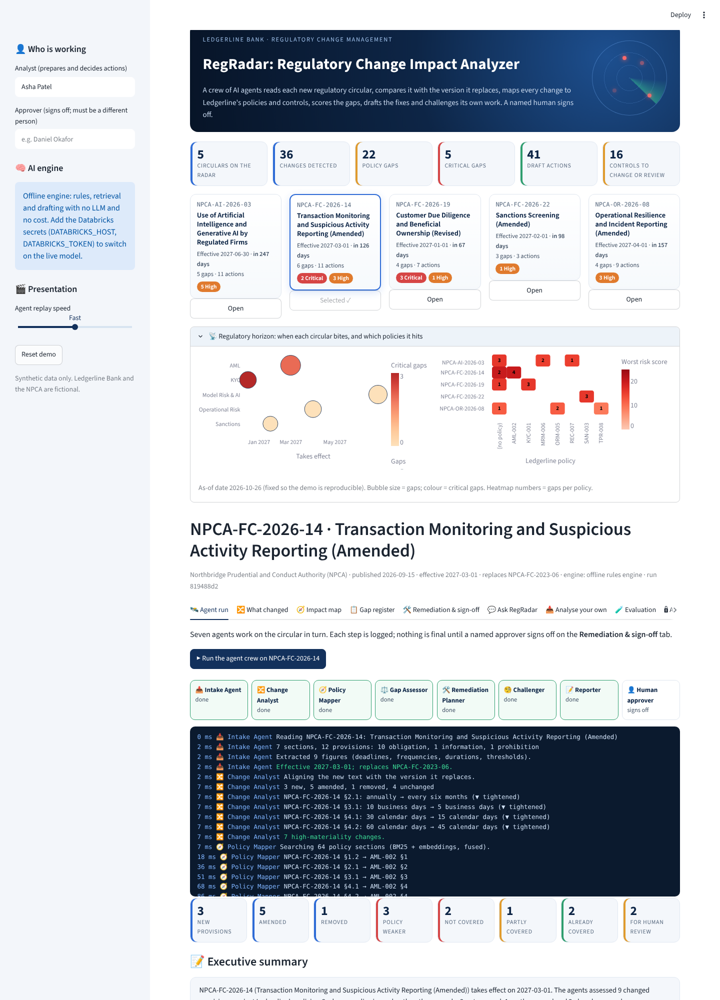
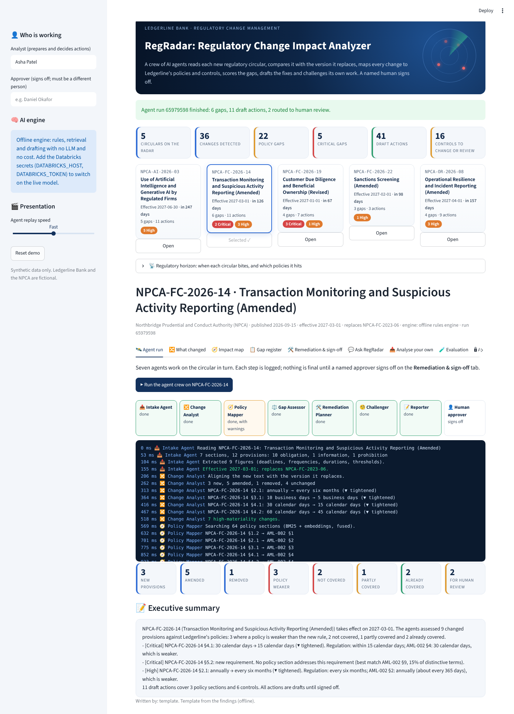

# 05 · RegRadar: GenAI Regulatory Change Impact Analyzer

A regulator publishes a new or amended circular. Within seconds, a **crew of seven AI agents** reads it, compares it word by word with the version it replaces, finds the bank policies and controls it lands on, decides where **Ledgerline Bank** (fictional) no longer complies, scores the risk, drafts the fixes and challenges its own work. A named analyst decides every action and a different person signs off. Every step is written to a tamper-evident audit trail.

> Independent, AI-assisted portfolio project. Ledgerline Bank, the Northbridge Prudential and Conduct Authority (NPCA) and every circular, policy and control are synthetic. Not affiliated with any real institution.





## The agent crew

| Agent | What it does |
|---|---|
| 📥 Intake | Reads the circular, splits it into sentence-level provisions, classes each as obligation / prohibition / permission / information, extracts every figure (deadlines, frequencies, retention periods, thresholds) |
| 🔀 Change Analyst | Aligns old and new versions, classes each provision NEW / AMENDED / UNCHANGED / REMOVED, finds the figures that moved and builds a redline |
| 🧭 Policy Mapper | Hybrid search (BM25 + embeddings, reused from Project 1) over 64 policy sections, sentence matching, figure matching, retries with a narrower query when it finds nothing good |
| ⚖️ Gap Assessor | CONFLICT / PARTIAL / MISSING / COVERED, with a written rationale, the affected controls and a risk score (impact × likelihood) |
| 🛠️ Remediation Planner | Exact policy redlines, new clauses, control reconfigurations, owners and due dates |
| 🧐 Challenger | Flags low-confidence and borderline verdicts for a person; optionally asks a Databricks foundation model for a second opinion (the model can add flags, never change a verdict) |
| 📝 Reporter | Executive summary, written by the model when connected and checked so it can't introduce a number that isn't in the findings |
| 👤 Human approver | Decides each action with comments, clears flags, four-eyes sign-off, exports the impact-assessment pack |

## What's in the app

| Tab | |
|---|---|
| Horizon (top of the page) | Five circulars on a deadline timeline with gap counts and a risk heatmap |
| 🛰️ Agent run | Replays the crew working: each agent's steps, live counters, the summary |
| 🔀 What changed | Every change with a word-level redline and the figures that moved (e.g. SAR filing 30 → 15 days) |
| 🧭 Impact map | Traceability graph: circular → provisions → policies → controls → actions |
| 📋 Gap register | Status, rating, policy, confidence, rationale, both sentences side by side |
| 🛠️ Remediation & sign-off | Accept / edit / reject each action, clear Challenger flags, four-eyes sign-off, download the pack |
| 💬 Ask RegRadar | Questions in plain English, answered from the findings with citations (tool-calling agent when a model is connected) |
| 📄 Analyse your own | Paste any circular text (synthetic or public) and the crew assesses it against the policy library |
| 🎯 Evaluation · 🔒 Audit trail | Scores against the answer key; the hash-chained log, verified |

## Verified results (this build)

| Check | Result |
|---|---|
| Five circulars (AML, KYC, AI model risk, operational resilience, sanctions) | 36 changes found, 22 gaps (5 Critical, 13 High, 4 Medium), 41 draft actions, 16 controls to change or review |
| Change detection, against a hand-written answer key | 100% of 44 provisions; 100% of 14 figure changes (old value, new value, tighter or looser) |
| Gap status | 91% (30 of 33). Recall and precision of gap detection 100% / 100%. **0 unsafe misses** (no real gap reported as covered), 0 false alarms |
| The 3 wrong statuses | All borderline PARTIAL calls, and **all 3 were sent to human review** by the Challenger |
| Policy citation accuracy | 82% (development 87%, held-out 60%) |
| Held-out circular (sanctions, written after thresholds were frozen) | First run 80% (4 of 5) with one false alarm. The two causes were fixed generally; now 100% of 5. Both numbers are reported |
| Automated tests (`pytest`) | 57 passed for this project, including the Streamlit app driven by `AppTest` and the LLM paths with scripted fake models |
| Browser test (Playwright, 11 steps against the running app) | All passed; screenshots in `docs/screenshots/` |
| Databricks notebook | Ran end to end on **local Spark 4.1.3**, offline and with a scripted fake model. **Not yet run on a Databricks workspace** |
| Live Databricks foundation model | **Not yet run.** Tested with scripted fakes only |
| Public hosted URL | **Not yet deployed** |

Full report: [docs/evaluation/eval_report.md](docs/evaluation/eval_report.md).

## Run it

From the repository root:

```bash
pip install -r requirements-dev.txt
streamlit run projects/p5_reg_change/app.py      # the app (runs fully offline)
python projects/p5_reg_change/evaluate.py        # score against the answer key
pytest projects/p5_reg_change                    # tests
```

### Deploy on Streamlit Community Cloud (free)

1. Go to `https://share.streamlit.io` and sign in with GitHub.
2. **Create app** → repository `nipunrg1990rocks-dev/banking-ai-portfolio`, branch `main`, main file `projects/p5_reg_change/app.py`.
3. Click **Deploy**. It runs offline with no secrets.

Optional, to switch on the Databricks model inside the app: in the app's **Settings → Secrets**, add `DATABRICKS_HOST`, `DATABRICKS_TOKEN` and, if you want a specific endpoint, `DATABRICKS_LLM_ENDPOINT`. Type them there yourself; never paste a token into chat or the repository.

### On Databricks Free Edition

1. **Workspace → Create → Git folder**, paste `https://github.com/nipunrg1990rocks-dev/banking-ai-portfolio`.
2. Open `projects/p5_reg_change/databricks/00_regradar_on_databricks` and click **Run all**.
3. It finds a free foundation-model endpoint with the notebook's own sign-in (no API key), runs the crew on every circular, writes Bronze / Silver / Gold Delta tables under `workspace.regradar`, classifies every provision with `ai_query()` in SQL, and scores offline vs model-assisted.

## Documentation

- [Architecture: diagrams, decision rules, risk scoring, where the LLM sits, controls, limitations](docs/architecture.md)
- [Interview pack: summary, demo scripts, 35 Q&A, code walkthrough, resume lines, your role](docs/interview_pack.md)
- [Evaluation report](docs/evaluation/eval_report.md)
