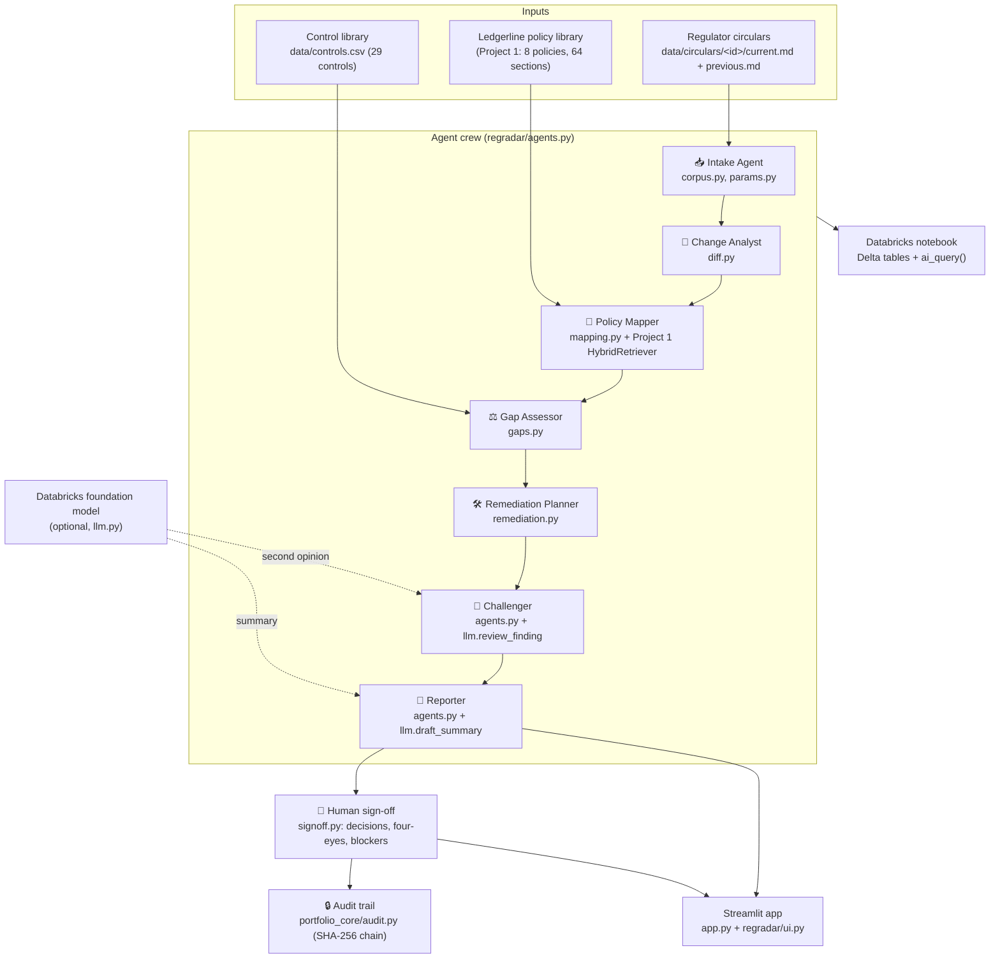
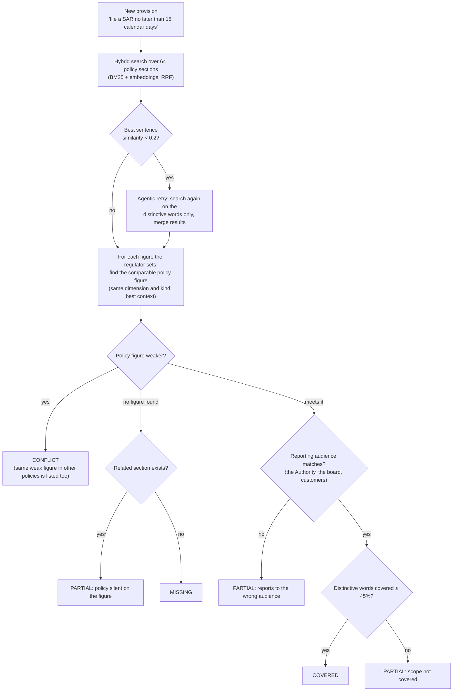
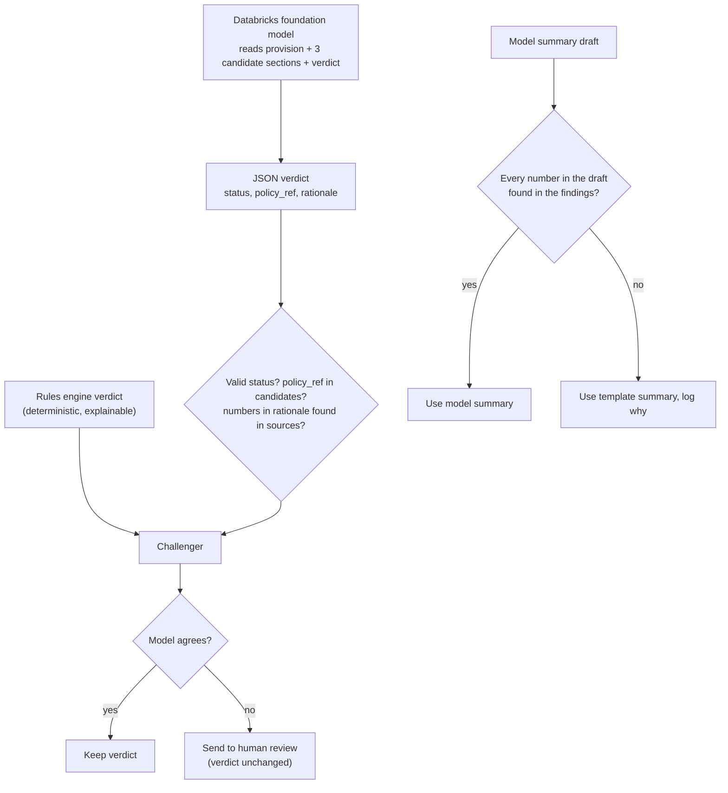

# Architecture: RegRadar, the GenAI Regulatory Change Impact Analyzer

Independent, AI-assisted portfolio project. Ledgerline Bank, the Northbridge Prudential and Conduct Authority (NPCA) and every circular, policy and control are synthetic.

## 1. What it does

A regulator publishes a new or amended circular. RegRadar's agents:

1. read it and extract every duty and every figure (document intelligence);
2. compare it word by word with the version it replaces (change comparison);
3. find the Ledgerline policy sections and controls each change lands on (RAG + control mapping);
4. decide whether the bank already complies, and score the risk with a written rationale (gap and risk scoring);
5. draft the fixes: policy redlines, new clauses, control reconfigurations, with owners and due dates (remediation);
6. challenge their own work and send doubtful findings to a person (Challenger, optional LLM second opinion);
7. write the executive summary.

A named analyst decides each action and a different named approver signs off (four-eyes). Everything is written to a hash-chained audit trail.

## 2. Components

| Module | Responsibility |
|---|---|
| `regradar/corpus.py` | Loads circulars (Markdown with front matter, or pasted plain text), splits sections into provisions, classes each as obligation / prohibition / permission / information. Loads Project 1's policies with Project 1's parser, and the control library. |
| `regradar/params.py` | Finds figures (time, percent, money, frequency words such as "annually", "once per month"), normalises them (days, percent, USD) and labels the kind: deadline, frequency, minimum duration, threshold. The kind decides which direction is stricter. |
| `regradar/diff.py` | Aligns old and new provisions (TF-IDF cosine with numbers masked, greedy one-to-one, threshold 0.45), classes NEW / AMENDED / UNCHANGED / REMOVED, pairs figures by surrounding words and marks them tightened or loosened, builds the word-level redline. |
| `regradar/mapping.py` | Section retrieval with Project 1's `HybridRetriever` (BM25 + LSA embeddings, Reciprocal Rank Fusion), sentence matching, figure matching (context overlap + sentence similarity + rank + domain prior), IDF-weighted term coverage. |
| `regradar/gaps.py` | The decision rules (below), control impact, risk scoring. |
| `regradar/remediation.py` | Draft actions: exact policy redlines, new clauses, control reconfiguration with the new figure, owners and due dates. |
| `regradar/agents.py` | The crew, the trace events the app replays, the Challenger checks, the template summary. |
| `regradar/llm.py` | Databricks Model Serving client (OpenAI-compatible REST), endpoint discovery, JSON parsing, the reviewer and summary prompts, the number grounding check. |
| `regradar/ask.py` | Ask RegRadar: read-only tools, an offline intent router, and an LLM tool-calling loop with a grounding check. |
| `regradar/signoff.py` | Decisions, comments, review of flags, four-eyes, sign-off blockers, audit events. |
| `regradar/report.py` | The Markdown impact-assessment pack. |
| `regradar/evaluation.py`, `evaluate.py` | Scores against the answer key, development and held-out splits, optional MLflow logging. |

## 3. How one provision is assessed

Provisions with no figure use term coverage and sentence similarity: COVERED at ≥ 62% coverage, PARTIAL at ≥ 30% (or a strong sentence match), otherwise MISSING. AMENDED provisions are judged only on what changed (the moved figures and the inserted words); NEW provisions on their whole text. UNCHANGED provisions are not re-assessed (assumed compliant before), and REMOVED ones are reported as simplification opportunities.

## 4. Risk scoring

`score = impact × likelihood` (1 to 25), with every factor written out:

- **Impact:** 4 for financial crime domains (AML, KYC, sanctions), 3 otherwise; +1 when the rule involves reporting to the regulator or the board.
- **Likelihood:** CONFLICT 4, MISSING 4, PARTIAL 2, COVERED 1; +1 when a mapped control was last tested "Ineffective" or "Partially effective".
- **Rating:** Critical ≥ 20, High ≥ 12, Medium ≥ 6, else Low. A gap whose rule takes effect within 90 days is raised one level.

## 5. Where the LLM sits (and where it doesn't)

The model can add review flags and write prose. It cannot change a status, cite a section it was not shown, or introduce a number that is not in the sources. With no model connected, everything runs offline and the app says so.

**Backend:** a Databricks Model Serving foundation-model endpoint, called over its OpenAI-compatible REST API (`/serving-endpoints/<name>/invocations`). `DatabricksLLM.discover` lists the workspace's endpoints and keeps the first candidate that answers a probe. In the notebook it uses the notebook's own sign-in; in the app it reads `DATABRICKS_HOST` and `DATABRICKS_TOKEN` from Streamlit secrets. No paid API is used.

## 6. Databricks

`databricks/00_regradar_on_databricks.py` (Run all from the repository's Git folder):

| Layer | Table | Contents |
|---|---|---|
| Bronze | `regradar.bronze_circulars` | raw circular text and metadata |
| Silver | `regradar.silver_provisions` | one row per sentence: duty type, figures |
| Silver | `regradar.silver_changes` | changes with materiality and headline |
| Silver | `regradar.silver_ai_modality` | `ai_query()` classification of every provision vs the rules engine |
| Gold | `regradar.gold_gap_register` | status, policy, risk, review flag, model opinion |
| Gold | `regradar.gold_actions` | draft remediation actions |
| Gold | `regradar.gold_evaluation` | offline vs model-assisted scores |
| Audit | `regradar.agent_events` | every agent step |

The notebook was run end to end on **local Spark 4.1.3** (offline, and with a scripted fake model; `ai_query` is not available outside Databricks, and the notebook reports that and carries on). It has **not yet been run on a Databricks workspace**.

## 7. Controls

| Risk | Control |
|---|---|
| The AI is wrong about compliance | Deterministic, explainable rules; every finding shows the regulatory sentence, the policy sentence and the two figures; the Challenger flags low-confidence and borderline "not covered" verdicts; an optional model second opinion can only add flags. |
| Hallucinated numbers | Grounding check on every model output (summary, review rationale, chat answer). |
| Unreviewed changes go live | Every action starts as Proposed; Critical and High actions and every Challenger flag must be decided before sign-off. |
| Self-approval | Four-eyes: the approver cannot be anyone who decided an action or cleared a flag. |
| Tampering | SHA-256 hash-chained audit trail (`portfolio_core/audit.py`), verified in the app. |
| Prompt injection / PII in questions | `portfolio_core/guardrails.py` on Ask RegRadar. |
| Confidential documents pasted | Input limit (60,000 characters); the page tells users to paste synthetic or public text only; nothing is stored beyond the session. |

## 8. Design trade-offs

- **Rules first, LLM second.** A compliance verdict must be reproducible and explainable to an auditor. The rules engine gives the same answer every time and shows its evidence; the model is used where it adds value (challenge, prose, Q&A) and is fenced by checks.
- **Local embeddings.** Reusing Project 1's LSA embeddings keeps the app free and offline. On Databricks, Vector Search with a hosted embedding model could replace `HybridRetriever` behind the same interface.
- **Sentence-level provisions.** Regulators often put several duties in one paragraph; sentence granularity gives sharper citations. Multi-duty sentences are handled by pairing figures by their surrounding words.
- **Thresholds tuned on synthetic data.** They are documented constants in `gaps.py`. A held-out circular was written after they were frozen to test generalisation (see the evaluation report).

## 9. Known limitations

- Synthetic circulars written in a consistent style; real regulation is longer, cross-references other rules and uses defined terms. Expect lower accuracy on real text.
- Figure extraction covers time, percent, money and common frequency phrases; it does not read tables, counts ("three layers") or conditional thresholds.
- Status accuracy on the five circulars is 91% (30 of 33). The three errors are borderline PARTIAL vs MISSING / CONFLICT calls, all sent to human review by the Challenger. Policy citation accuracy is 82%: weakest when the right section has little wording in common with the rule.
- On the held-out circular's first run, "once per month" was not recognised (a false alarm) and a sanctions rule was matched to an AML policy figure. Both were fixed generally (frequency phrases, a domain prior) after that run, so the held-out circular has now been seen; its first-run scores are reported separately.
- The live Databricks model path is tested with scripted fakes only. It has not been run against a real endpoint.
