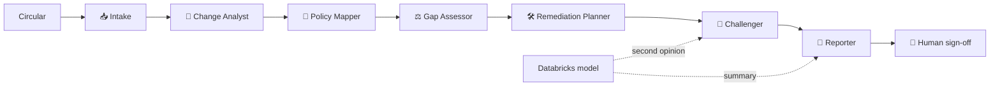

# Interview Pack: RegRadar, the GenAI Regulatory Change Impact Analyzer

> How to describe it: "I developed this independent project using AI-assisted development tools. I defined the regulatory scenarios, the policies and controls, the decision rules and the answer key from my banking experience. I directed the AI tools that wrote the code, reviewed what they produced, and tested and validated the results." Do not attribute it to any employer. Do not claim you hand-wrote the code.

---

## 1. The 60-second executive summary

"Every year a bank receives hundreds of regulatory updates. For each one, compliance has to work out what changed, which policies and controls it hits, whether the bank still complies, and what to fix by when. Today that's weeks of reading and spreadsheets, and the risk is a missed deadline or a policy that quietly falls out of line. I built **RegRadar**, a crew of seven AI agents that does the first pass in seconds. It reads a new circular, compares it word by word with the version it replaces, finds every figure that moved (a SAR deadline cut from 30 to 15 days, an ownership threshold from 25% to 10%), searches the bank's policy library, and decides for each rule whether the bank's policy **conflicts, partially covers, misses or already covers** it. It scores the risk, drafts the exact policy redlines and control changes with owners and due dates, then **challenges its own work** and sends anything doubtful to a person. A **Databricks foundation model** gives a second opinion and writes the summary, but it can only add review flags, never change a verdict, and anything it writes is checked for invented numbers. A named analyst decides every action, a different person signs off, and everything goes into a tamper-evident audit trail. On a hand-written answer key it finds **every gap with no unsafe misses**, gets 91% of statuses exactly right, and the three it gets wrong were all sent to human review."

## 2. Business problem and banking use case

- **Users:** regulatory change management, compliance advisory, policy owners, control owners, second-line risk, internal audit.
- **Pain:** regulatory change volume is high and documents are long. Comparing versions, finding affected policies and tracking remediation is manual. The costly failures are (1) a tightened figure nobody noticed, (2) a policy updated but the control that enforces it not reconfigured, (3) no evidence trail of who decided what.
- **What RegRadar gives them:**
  - an instant, explainable first-pass impact assessment for every new circular
  - traceability from each regulatory sentence to the policy section, the control and the remediation action
  - a risk-ranked register with deadlines driven by the effective date
  - human decision, four-eyes sign-off and a hash-chained audit trail
- **What it is not:** an autonomous compliance decision. It is a drafting and triage tool; accountable people decide.

## 3. Key numbers (from the committed build)

| Measure | Value |
|---|---|
| Circulars (AML, KYC, AI model risk, operational resilience, sanctions) | 5 (4 amended with previous versions, 1 brand new) |
| Policy library / controls | 8 policies, 64 sections (from Project 1) / 29 controls |
| Changes found | 36 |
| Gaps | 22: 5 Critical, 13 High, 4 Medium |
| Draft actions / controls to change or review | 41 / 16 |
| Change detection | 100% of 44 provisions |
| Figure changes (old, new, direction) | 100% of 14 |
| Gap status accuracy | 91% (30 of 33) |
| Gap recall / precision | 100% / 100% |
| Unsafe misses / false alarms | 0 / 0 |
| Wrong statuses sent to human review | 3 of 3 |
| Policy citation accuracy | 82% (dev 87%, held-out 60%) |
| Held-out circular, first run | 80% (4 of 5), 1 false alarm; fixed generally, now 100% |
| Automated tests (this project) | 57 |
| Live Databricks model / Databricks workspace run / public URL | Not yet run / not yet run / not yet deployed |

## 4. What each technology does (plain English, then technical)

| Technology | Plain English | Technical |
|---|---|---|
| Agent crew | Seven specialists hand work to each other, like a regulatory change team | Plain-Python orchestrator, typed hand-offs, `TraceEvent`s replayed in the UI |
| Document intelligence | Reads the circular and pulls out every duty and every number | Front-matter parser, sentence split, modality classifier, regex figure extraction with normalisation (days, %, USD) and kind (deadline, frequency, duration, threshold) |
| Change comparison | Shows what's new, changed or deleted, like track changes | TF-IDF alignment with numbers masked, greedy one-to-one at cosine ≥ 0.45, `difflib` word redline, figure pairing by surrounding words |
| RAG retrieval | Finds the bank's policy text each rule lands on | Project 1's `HybridRetriever` (BM25 + LSA embeddings, Reciprocal Rank Fusion), sentence-level TF-IDF, IDF-weighted term coverage, agentic retry |
| Gap rules | Decides compliant or not, and says why | Deterministic decision tree: figure comparison by kind, audience check, coverage thresholds |
| Risk scoring | How bad and how likely | impact × likelihood (1-25), +1 level if effective within 90 days |
| Databricks foundation model | A second pair of eyes and a writer | Model Serving REST (OpenAI-compatible), endpoint discovery, JSON verdicts, grounding check |
| `ai_query()` | Uses the model inside SQL | Databricks AI Functions classify every provision; compared with the rules engine |
| Delta tables | Results stored like a bank's data platform | Bronze circulars, Silver provisions and changes, Gold gap register and actions, agent events |
| Streamlit | The app | Custom CSS, Altair charts, graphviz traceability graph, `AppTest` tests |
| Audit trail | Who did what, provably | SHA-256 hash chain in `portfolio_core/audit.py` |

## 5. Diagrams

See [architecture.md](architecture.md): components and agent crew, how one provision is assessed (decision tree), and where the LLM sits.

## 6. Three-minute demo script

1. **(20 s) Horizon.** "Five circulars from a fictional regulator, on a deadline timeline. The heatmap shows where the risk sits: financial crime is hottest."
2. **(40 s) Agent run on the AML circular.** Click *Open* on NPCA-FC-2026-14 and replay. "Watch the crew: Intake finds 12 provisions and their figures; the Change Analyst finds what moved; the Policy Mapper searches 64 policy sections; the Gap Assessor decides; the Challenger sends two findings to a person."
3. **(30 s) What changed.** "The SAR filing deadline went from 30 to 15 calendar days. Here's the redline and the figure that moved."
4. **(30 s) Gap register.** "Our AML policy section 4 still says 30 days, so that's a CONFLICT, rated Critical: financial crime impact 5 because it involves reporting to the regulator, likelihood 4. Here's the regulatory sentence and our policy sentence side by side."
5. **(30 s) Impact map, then Remediation.** "Traceability from the rule to the policy, the SAR control and the action. The planner drafted the exact redline and the control reconfiguration, with an owner and a due date 30 days before the rule takes effect. I accept one, reject one with a comment."
6. **(30 s) Sign-off and audit.** "Sign-off is blocked until every Critical and High action and every Challenger flag is decided, and the approver must be a different person. The audit chain verifies."

## 7. Ten-minute demo script

1. **Problem (1 min):** the regulatory change lifecycle, what goes wrong, why a first-pass tool helps.
2. **Horizon and agent run (1.5 min):** as above, pointing at the live counters and the hand-offs.
3. **What changed (1 min):** FC-19 KYC: beneficial ownership 25% → 10%, re-verification 90 → 30 days; review cycles 36 → 24 months. Explain direction: a smaller deadline is stricter, a smaller threshold is stricter, a higher frequency is stricter.
4. **Gap register (2 min):** three cases:
   - CONFLICT: FC-14 §4.1 SAR 30 → 15 days vs AML-002 §4.
   - PARTIAL by audience: OR-08 §1.1 says notify **the Authority** within 4 hours; our policy notifies internal management within 2 hours. The number passes but the audience is wrong.
   - MISSING with review: AI-03 §2.1 (a senior manager accountable for AI). No policy covers it, and the Challenger sends it to a person because a nearby section exists.
5. **Where the LLM sits (1.5 min):** the architecture diagram. The model reviews each verdict as JSON; if it disagrees the finding goes to a person and the verdict stays. Its summary is checked: every number must exist in the findings, otherwise the template summary is used and the reason is logged.
6. **Ask RegRadar (1 min):** "Which Critical gaps are due first?" and "What does AML-002 §4 say?" Answers come from tools over the findings, with citations; an injection attempt is blocked by the guardrails.
7. **Analyse your own (30 s):** paste a short synthetic circular; the crew assesses it with no previous version, so everything is NEW.
8. **Evaluation and honesty (1 min):** the answer key, 0 unsafe misses, the 3 errors all flagged; the held-out circular's first-run 80% and what I fixed.
9. **Databricks (30 s):** the notebook: Delta tables, `ai_query()` classification, offline vs model-assisted scores.

## 8. Code walkthrough (where things are)

| Question | File |
|---|---|
| How are circulars parsed and provisions classed? | `regradar/corpus.py` |
| How are figures found and compared? | `regradar/params.py` (`extract_quantities`, `meets`, `direction`) |
| How are versions compared? | `regradar/diff.py` (`compare`) |
| How is the policy found? | `regradar/mapping.py` (`PolicyMatcher`) |
| How is a status decided and scored? | `regradar/gaps.py` (`assess`, `score_risk`) |
| How are fixes drafted? | `regradar/remediation.py` (`plan`) |
| How do the agents run? | `regradar/agents.py` (`run_assessment`, `CREW`) |
| How is the model called and fenced? | `regradar/llm.py` (`DatabricksLLM`, `review_finding`, `grounding_check`) |
| How does Ask work? | `regradar/ask.py` (`Tools`, `offline_answer`, `LLMAgent`) |
| How is sign-off enforced? | `regradar/signoff.py` (`Workflow`) |
| How is it scored? | `regradar/evaluation.py`, `data/eval/answer_key.json` |
| Databricks | `databricks/00_regradar_on_databricks.py` |

## 9. Interview questions and answers

### Business and regulatory change

1. **What problem does this solve?**
   The first pass of regulatory change impact assessment: what changed, where it lands, whether we comply, what to fix and by when. It turns weeks of reading into minutes, and leaves the decisions to accountable people.
2. **Who uses it, and how does it fit the change lifecycle?**
   Horizon scanning feeds circulars in; compliance advisory reviews the gap register; policy and control owners receive the draft actions; second line signs off; audit uses the trail. RegRadar sits between "circular published" and "remediation plan agreed".
3. **Why is the effective date important?**
   It drives urgency. Due dates are set 30 days before it (at least two weeks from today) and a gap whose rule takes effect within 90 days is raised one rating level.
4. **What's the difference between CONFLICT, PARTIAL and MISSING?**
   CONFLICT: our policy has a figure and it's weaker than the rule (30 days vs 15). PARTIAL: we cover the topic but not all of it (silent on the figure, wrong audience, or scope words missing). MISSING: nothing in the library addresses it. COVERED: the policy meets it, with evidence.
5. **What about provisions the regulator removed?**
   They're reported as OPPORTUNITY: a chance to simplify a policy or retire a control, not a gap.
6. **How would a bank measure value?**
   Time from publication to agreed remediation plan, number of late or missed changes, share of first-pass findings accepted by reviewers, audit findings on regulatory change.

### Design and the agents

7. **Why an agent crew instead of one big prompt?**
   Each step has a different job and a different test. Splitting them gives a visible hand-off, a unit test per agent, and a place to put a control (the Challenger) between the decision and the human.
8. **Is this "really" agentic?**
   It is a fixed pipeline of specialised agents with one adaptive behaviour (the Policy Mapper retries with a narrower query when its best match is weak), a self-challenge step, and a tool-calling chat agent. I chose a predictable crew over free-roaming agents because compliance needs the same answer every time.
9. **How does change detection work?**
   Provisions from the old and new versions are aligned by TF-IDF cosine with the numbers masked, so "30 days" vs "15 days" still matches as the same rule. Pairs above 0.45 are AMENDED or UNCHANGED; unmatched new ones are NEW, unmatched old ones REMOVED. Then figures are paired by their surrounding words and marked tightened or loosened.
10. **How do you know which direction is stricter?**
    By the kind of figure. A shorter deadline is stricter; a higher frequency is stricter; a longer minimum retention is stricter; a lower ownership threshold is stricter. The kind comes from the words around the number ("within", "every", "at least", "or more").
11. **How is the right policy section found?**
    Hybrid search from Project 1 (BM25 for exact terms, LSA embeddings for meaning, fused with Reciprocal Rank Fusion), then sentence-level matching, a small prior for the domain's home policy, and a figure match that compares context words.
12. **What's the agentic retry?**
    If the best sentence similarity is under 0.2, the mapper searches again on only the rule's distinctive words and merges the results. It's logged in the trace so you can see it happen.
13. **What does the Challenger check?**
    Low-confidence findings, and MISSING verdicts when a related section exists in the same domain or a near match was found: exactly the borderline calls where a person adds most value. With a model connected, any disagreement adds a flag too.
14. **Why is the risk score impact × likelihood?**
    It's how risk teams already think, and every factor is written out so a reviewer can argue with it. I recalibrated it after the first version rated 16 of 22 gaps Critical, which would make the rating useless.

### The LLM

15. **Which model, and does it cost anything?**
    A Databricks foundation-model endpoint in a Free Edition workspace, called with the notebook's own sign-in. No API key, no paid API. It is picked automatically by probing candidates. Everything also runs offline.
16. **Why is the LLM not the decision-maker?**
    A compliance verdict has to be reproducible and explainable to an auditor. The rules engine gives the same answer every time and shows its evidence. The model is used where it adds value (second opinion, prose, Q&A) and is fenced by checks.
17. **How do you stop it hallucinating?**
    It sees only the provision, the top candidate sections and the verdict. Its JSON must have a valid status and cite a section it was shown. Every number in its rationale, summary or chat answer must exist in the sources; otherwise the output is rejected and the template is used, with the reason logged.
18. **What if the model disagrees with the rules?**
    The finding is sent to human review, and the verdict stays as it was. The model can add flags, never remove or change one.
19. **What does `ai_query()` add?**
    It shows the same model used inside SQL on a Delta table: it classifies each provision's duty type, and the notebook reports agreement with the rules engine. That's how this would scale over thousands of documents.
20. **How does Ask RegRadar work?**
    With a model, it's a tool-calling loop (list circulars, get findings, get a policy section, top gaps; six rounds maximum) with a grounding check on the answer. Offline, an intent router answers the same questions from the same tools. The guardrails from `portfolio_core` block injection attempts and personal data.
21. **How did you test the LLM paths without a live model?**
    Scripted fake models that return chosen replies, including wrong statuses, bad JSON and invented numbers. The tests check that each is caught. The live model path has not yet been run, and I say so.

### Evaluation and quality

22. **How do you know it's right?**
    A hand-written answer key for all 44 provisions: change type, every figure change, expected status and the expected policy section. `evaluate.py` scores it on every run, and CI publishes the result.
23. **What's the most important metric?**
    Unsafe misses: a real gap reported as covered. That's the error that hurts a bank. It's zero. Second is whether wrong answers reach a person: all three did.
24. **What are the three errors?**
    All borderline PARTIAL calls: two the engine called MISSING and one CONFLICT. In each the policy touched the topic loosely. All three were flagged for review.
25. **Isn't the answer key biased, since you wrote the data?**
    Yes, that's the main caveat. To test generalisation, I wrote a fifth circular (sanctions) after the thresholds were frozen. First run: 80% status, one false alarm, 3 of 5 citations right. It exposed two weaknesses ("once per month" wasn't parsed; a sanctions rule matched an AML figure). I fixed both in a general way and reported the first-run numbers separately.
26. **Why is citation accuracy lower than status accuracy?**
    Sometimes the right section uses different words from the rule; the engine finds a neighbouring section that still lets it reach the right status. On Databricks, Vector Search with a stronger embedding model would be the next step.
27. **How is the app tested?**
    57 pytest tests, including the Streamlit app driven by `AppTest`, plus an 11-step Playwright browser test against the running app that takes the screenshots.

### Controls, data and deployment

28. **How is human oversight enforced?**
    Every action starts as Proposed. Reject or edit requires a comment. Sign-off is blocked while any Critical or High action or any Challenger flag is undecided, and the approver must be someone who did not decide anything (four-eyes).
29. **Why a hash-chained audit trail?**
    Each event includes the hash of the previous one, so editing or deleting a past event breaks the chain. The app verifies it on screen.
30. **What about confidential documents?**
    The demo uses synthetic data only. Pasted text is limited to 60,000 characters and kept only in the session. In a bank it would run inside the bank's Databricks workspace, with the model served there and access through Unity Catalog.
31. **What lands in Databricks?**
    Bronze circulars, Silver provisions and changes, Silver `ai_query` classifications, Gold gap register and actions, agent events and evaluation scores as Delta tables, so it can feed dashboards and a workflow tool.
32. **How would you deploy this in a bank?**
    A scheduled Databricks job triggered by the horizon-scanning feed, Vector Search over the real policy library, the model served in the workspace, findings pushed to the GRC tool (e.g. as issues with owners), model-risk validation with this evaluation as evidence.
33. **What would you build next?**
    Vector Search and a stronger embedding model for citations; table and cross-reference reading; feeding reviewer decisions back as labelled data; integration with the control-testing schedule.
34. **What are the limitations?**
    Synthetic circulars in a consistent style; real regulation is longer and cross-references other rules. Figure extraction doesn't read tables or counts. The live model and the workspace run are not yet verified.

### Your role

35. **What did you do yourself?**
    See section 12. In short: I designed the scenarios, the decision rules, the controls and the answer key, directed the AI tools, reviewed the output, and decided the trade-offs, including keeping the model out of the verdict.

## 10. Failure cases you can demonstrate or explain

| Scenario | What happens | Evidence |
|---|---|---|
| Policy figure weaker than the rule | CONFLICT, with both sentences and both figures | Gap register, `test_p5_gaps.py` |
| Number passes but the audience is wrong (internal vs the Authority) | PARTIAL with the reason | OR-08 §1.1 |
| Nothing in the library covers the rule | MISSING, and the Challenger sends it to a person if anything nearby exists | AI-03 §2.1 |
| Model returns a wrong status or invalid JSON | Flag added, verdict unchanged | `test_p5_llm.py`, `test_p5_agents.py` |
| Model summary invents a number | Template summary used, reason logged | `test_p5_llm.py` |
| Sign-off attempted with open Critical actions, or by the person who decided | Blocked with the reason | `test_p5_signoff.py` |
| Prompt injection in Ask | Blocked by guardrails | `test_p5_ask.py` |
| Oversized or empty pasted circular | Rejected with a message | `test_p5_corpus.py` |
| Audit log edited | Chain verification fails | `portfolio_core` tests |

## 11. Resume bullets (accurate and independent)

- Designed and built, with AI-assisted development, a GenAI regulatory change impact analyzer: a crew of seven agents that reads regulatory circulars, detects changes and moved figures, maps them to bank policies and controls with hybrid RAG, classifies gaps, scores risk and drafts remediation, with human four-eyes sign-off and a hash-chained audit trail.
- Evaluated it against a hand-written answer key of 44 provisions: 100% change detection, 91% gap-status accuracy, zero unsafe misses, and every wrong verdict routed to human review; tested generalisation on a held-out circular and reported first-run results.
- Integrated a Databricks foundation model as a fenced second opinion and summary writer (grounding checks, no verdict changes), with Delta Lake output tables and `ai_query()` classification in Databricks SQL; delivered a Streamlit app with 57 automated tests and browser tests.

## 12. Your role (say this plainly)

"I acted as product owner, subject-matter expert and test lead. From my experience in banking risk and controls, I wrote the regulatory scenarios, the policies and controls they land on, and the rules for when something counts as a conflict, a partial gap or a miss. I wrote the answer key by hand, and a held-out circular to check it wasn't tuned to my own data. I directed AI coding tools to build it, reviewed the code and the outputs, and pushed back where the results didn't make sense to a compliance reviewer: for example, when nearly everything came out Critical, or when an internal two-hour notification was being counted as meeting a four-hour duty to notify the regulator. I decided that the LLM must never change a verdict, only challenge it. I can walk through every module and explain every design choice."
