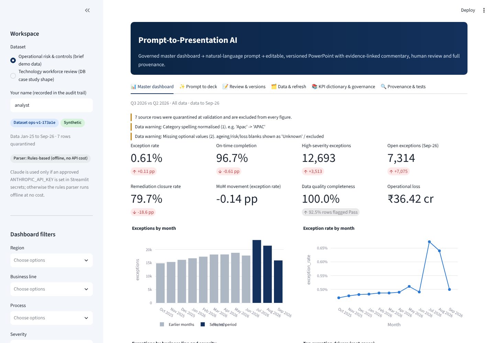

# 06 · Prompt-to-Presentation AI: Dynamic Executive Reporting Platform

One governed master dashboard replaces spreadsheet formula maintenance, chart copying and static PowerPoint rebuilding. A stakeholder types a request such as *"Create a six-slide APAC Q3 risk pack, compare Q2, rank top exception drivers, add commentary and speaker notes"*, gets a **genuinely editable .pptx** in seconds, then follows up (*"change APAC to EMEA and add high-severity exceptions"*, *"replace slide 4 with ageing"*, *"refresh using latest data"*). Every version is kept, every number is traceable to a governed query, and nothing is approved for distribution without a second person.

> Independent, AI-assisted portfolio project for a **fictional bank (Ledgerline Bank)**. All shipped data is synthetic. Not affiliated with any real institution.



## What it does

| Capability | Where |
|---|---|
| Two governed datasets: **operational risk** (21 months, 3 regions, 4 business lines, 5 processes, seeded anomalies) and a **technology workforce roster** with the same structure as a monthly resource tracker (the DB case-study shape) | `deckpilot/domains/`, `data/` |
| Validation gate: schema, category allowlists, ranges, duplicates, non-additive volume checks, formula-text neutralising, quarantine with reasons, upload limits; a new file only goes live after you activate it | `deckpilot/validation.py`, domain `load()` |
| Master dashboard with 5+ filters per dataset, 8 KPI tiles, trends, drivers, ageing, remediation, on-time, data quality; "create deck from this view" | `app.py` |
| Prompt box → validated `DeckSpec` (Pydantic + allowlists). Offline rules parser by default; Claude only if an approved key is configured, with the same validation and automatic fallback | `deckpilot/parser.py`, `deckpilot/spec.py` |
| Follow-ups: change scope, show only X, add/remove months, compare YoY / prior period / a named quarter, replace or regenerate slide N, add/remove slides, resize, fresh copy, refresh on latest data | `apply_followup()` |
| Allowlisted SQL only: parameterised DuckDB queries over approved tables and columns, each with a fingerprint written to provenance | `deckpilot/store.py` |
| Editable PowerPoint: native charts (incl. native waterfalls), native tables, KPI tiles, cards, footnotes, branded templates, speaker notes with talk track, evidence, caveats and provenance; DRAFT / APPROVED stamps | `deckpilot/render.py` |
| Templates: Executive Summary, Risk & Controls, Operations Performance (ops risk); Workforce Review, Workforce Executive Summary, Cost & Vendor (workforce) | domain `templates` |
| Evidence-linked commentary: each sentence carries metric, value, window and filters; interpretations labelled *Hypothesis*; missing data, quarantine and stale/planned months disclosed | domain slide builders |
| Versioning: append-only versions, each with prompt, parser mode, spec, dataset version + SHA-256, filters, period, query fingerprints, KPI definitions, file hash, review status | `deckpilot/versioning.py` |
| Review: editable commentary (saved as a new version, unverified numbers flagged), review-comment panel exported to speaker notes and a CSV review log, maker-checker approval | `deckpilot/service.py` |
| Hash-chained audit log of every dataset, prompt, rejection, version, edit, comment and decision | `portfolio_core/audit.py` |
| PDF export via LibreOffice where installed | `render.to_pdf()` |

## Verified results (this build, 31 Oct 2026)

| Check | Result |
|---|---|
| Automated tests (`pytest projects/p6_prompt_to_presentation`) | **60/60 passed**: metrics, validation, parser and follow-ups, injection resistance, query allowlist, PPTX integrity, versioning, review controls, audit tamper detection, Streamlit AppTest ([details](docs/test_results.md)) |
| Whole repository suite | 194 passed, 26 skipped (Project 02 Spark tests skip without Java locally; CI runs them) |
| Browser test (Playwright, acceptance demo A–G against the running app) | **11/11 steps passed**; screenshots in [docs/screenshots](docs/screenshots/) |
| Scripted acceptance demo (`run_demo.py`) | A–G complete in about 12 s with PDF export; output in [sample_output](sample_output/) |
| Reconciliation with the original case-study roster (local only, file not committed) | **13/13** published figures reproduced (134 on contract, EUR 610,393.55 Q1 T&M India, ...) |
| Live Claude parsing | Built and unit-tested with a fake client; **not run against the real API** (needs spend approval) |
| Hosted URL | https://banking-ai-portfolio-bbh7cdwafuzerlfuafrmjr.streamlit.app (deployed and smoke-checked by Nipun on 31 Oct 2026: generate, follow-up download, audit chain) |

## Acceptance demo

| Step | How |
|---|---|
| A | Prompt tab → example 1 → **Generate deck** → `D-0001 v1`, six slides |
| B | Follow-up chip **Change APAC to EMEA and add high-severity exceptions** → `v2` (seven slides) |
| C | Review & versions → both versions listed, each with its own file and hash |
| D | Data & refresh → **Use the sample modified dataset** → validation report (9 rows quarantined, Oct 2026 added) → **Activate** → follow-up **Refresh using latest data** → `v3` on `ops-v2-…` |
| E | Review & versions → edit the commentary slide → **Save as new version** |
| F | **Download editable .pptx** (and **Export PDF**) |
| G | Provenance & tests → audit chain, provenance JSON, test results |

## Run it

```bash
pip install -r requirements.txt
streamlit run projects/p6_prompt_to_presentation/app.py
pytest projects/p6_prompt_to_presentation                 # tests
python projects/p6_prompt_to_presentation/run_demo.py     # scripted A–G demo (Markdown report)
node scripts/e2e_smoke_p6.js http://localhost:8501        # browser test (needs Playwright)
python projects/p6_prompt_to_presentation/generate_data.py  # regenerate synthetic data
```

## Deploy (Streamlit Community Cloud, free)

1. https://share.streamlit.io → **Create app** → repository `nipunrg1990rocks-dev/banking-ai-portfolio`, branch `main`, main file `projects/p6_prompt_to_presentation/app.py`, Python 3.12.
2. `packages.txt` in this folder asks Streamlit Cloud to install LibreOffice for PDF export. If the build is slow or fails, delete that file: the app still works and the PDF button explains that PDF is unavailable on that host.
3. No secrets are needed. Live Claude parsing is off until an `ANTHROPIC_API_KEY` is added under app **Settings → Secrets** after spend approval.

## Documents

- [Architecture and data-flow diagrams](docs/architecture.md)
- [Data dictionary and KPI definitions](docs/data_dictionary.md)
- [Interview pack: demo scripts, 30 Q&As, resume bullets](docs/interview_pack.md)
- [Test results](docs/test_results.md)
- [Downloadable documentation (PDF)](docs/Ledgerline_Prompt_to_Presentation_Documentation.pdf), rebuilt with `python build_docs_pdf.py`
- [LinkedIn post drafts](docs/linkedin_post.md)
