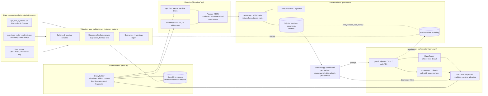

# Architecture: Prompt-to-Presentation AI

## Component view



## End-to-end data flow for one prompt

```mermaid
sequenceDiagram
    participant U as Stakeholder
    participant App as Streamlit
    participant G as Guard
    participant Pr as Parser (rules / Claude)
    participant Sp as DeckSpec validator
    participant Q as QueryBuilder (DuckDB)
    participant Dm as Domain KPIs + commentary
    participant R as python-pptx renderer
    participant V as Version store + audit

    U->>App: "Six-slide APAC Q3 risk pack, compare Q2, rank drivers, commentary"
    App->>G: check length, injection, SQL/code, PII
    G-->>App: sanitised prompt (or rejection, logged)
    App->>Pr: interpret against domain vocabulary
    Pr->>Sp: {template, filters, months, comparison, slides, top_n}
    Sp-->>Pr: valid only if every value is allowlisted and in the dataset
    Sp->>Q: parameterised SELECTs (allowlisted columns)
    Q-->>Dm: rows + query fingerprints
    Dm-->>R: payload (all numbers, evidence, disclosures)
    R->>V: new .pptx file (never overwrites), SHA-256
    V-->>App: version D-0001 v1, status DRAFT
    U->>App: follow-up "change APAC to EMEA and add high-severity exceptions"
    App->>V: v2 built on the pinned dataset; v1 kept
```

## Key design decisions

| Decision | Why |
|---|---|
| Prompt → **validated spec**, never prompt → SQL | The model (or rules) can only choose from allowlisted templates, slide types, dimensions and values. There is no path from user text to an executed query, so prompt injection cannot reach data. |
| **Rules parser by default**, Claude optional | Works with zero cost and no credentials; Claude improves phrasing coverage when an approved key exists, and its JSON goes through the same validator with automatic fallback. |
| **Payload JSON** between analytics and rendering | Every number on a slide is stored with the version, so approval re-renders the identical content with an "APPROVED" stamp, and provenance can be audited without re-querying. |
| **Native** charts and tables | Charts are editable in PowerPoint (Edit Data). Waterfalls are stacked columns with an invisible base series; a Sankey and Marimekko from the original case-study deck are replaced by stacked bars so they stay editable. |
| Versions are **append-only** and **pinned to a dataset** | A follow-up keeps the parent's dataset unless the user says "refresh using latest data", so numbers never change silently; every version keeps its own file and hash. |
| Volume is **non-additive** | In the ops-risk data, transaction volume repeats on every cluster row; KPIs de-duplicate at process-month before summing, and severity filters narrow only the numerator. |
| Review comments in a **panel**, exported to notes + CSV log | python-pptx cannot write native threaded comments; the platform says so and exports comments transparently. |
| **Maker-checker** approval | The author cannot approve, open comments block approval, and edited commentary containing numbers not found in the slide data must be confirmed as verified. |

## Where things live

| Path | Purpose |
|---|---|
| `app.py` | Streamlit UI (6 tabs) |
| `deckpilot/spec.py` | Pydantic `DeckSpec`, period labels, comparison windows |
| `deckpilot/parser.py` | Guard, rules parser, follow-up interpreter, optional Claude parser |
| `deckpilot/validation.py` | Upload reading, limits, validation report, quarantine |
| `deckpilot/store.py` | Dataset versions, DuckDB query builder with allowlists and fingerprints |
| `deckpilot/domains/ops_risk.py` | Ops-risk data contract, KPIs, slides, synthetic generator |
| `deckpilot/domains/workforce.py` | Workforce roster loader, KPIs, case-study slide set, synthetic roster |
| `deckpilot/payload.py` | Slide payload contract, formatting, safe division, unverified-number check |
| `deckpilot/render.py` | python-pptx renderer and LibreOffice PDF export |
| `deckpilot/versioning.py` | SQLite versions, comments, reviews, review log |
| `deckpilot/service.py` | Orchestration used by the app, tests and `run_demo.py` |
| `portfolio_core/` (repo root) | Shared guardrails, hash-chained audit log, Claude client |

## Production path (not built; needs an authorised workspace)

* Replace DuckDB with Databricks SQL over Delta tables governed by Unity Catalog (row filters for region entitlements); keep the same `QueryBuilder` contract.
* Store `.pptx` files in object storage with retention, and versions/audit in PostgreSQL.
* SSO identity instead of a typed name; reviewer roles from an entitlement system.
* LibreOffice in a sidecar container for PDF export.

## Known limitations

* State is per browser session and ephemeral on Streamlit Community Cloud (a restart resets it); this is deliberate for a public demo.
* The rules parser covers the documented vocabulary; unusual phrasing is reported as "could not interpret" rather than guessed.
* Commentary is template-generated from computed metrics; it does not explain causes. Root causes are what control owners recorded, and interpretations are labelled as hypotheses.
* PDF export needs LibreOffice on the host (`packages.txt` requests it on Streamlit Cloud).
