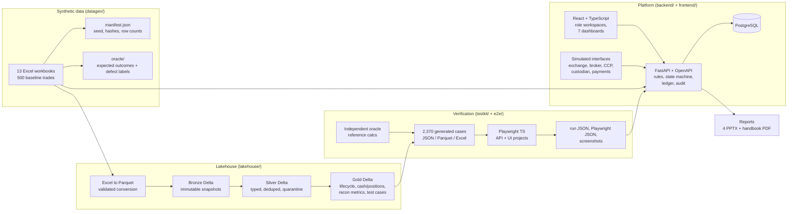

# CapitalFlow 360 — Architecture

CapitalFlow 360 is an **independent portfolio project**: a simulated multi-asset capital
markets processing platform built on synthetic data. It is not connected to any real venue,
broker, clearing house, custodian or payment system, does not price instruments to production
standard and makes no claim of regulatory compliance.

> Folder note: the brief suggested `projects/p6_capitalflow360`. `projects/p6_prompt_to_presentation`
> already exists in this repository, so CapitalFlow 360 lives in `projects/p7_capitalflow360`.
> It stays in the shared monorepo because it reuses the repository's CI, site and conventions; it has
> its own Docker Compose stack, so it can be lifted into a separate repository without changes.

## 1. Components

| Layer | Technology (pinned in lock files) | Folder |
|---|---|---|
| Frontend | React 19, TypeScript 5.9, Vite 7, MUI 7, MUI X Data Grid 8, Recharts 3 | `frontend/` |
| Backend | Python 3.13, FastAPI 0.163, Pydantic 2.13, SQLAlchemy 2.0, Alembic 1.20, PostgreSQL 16 | `backend/` |
| Lakehouse | PySpark 4.1, Delta Lake 4.4 (local); Databricks serverless notebooks + job (cloud) | `lakehouse/` |
| Data generation | Python, pandas, openpyxl, fixed seed | `datagen/` |
| Independent oracle + case generation | Python `fractions`/`decimal`, hypothesis, allpairspy | `testkit/` |
| Automation | Playwright Test (TypeScript) 1.63 | `frontend/e2e/` |
| Reporting | pptxgenjs 3.12 decks (native editable charts), HTML printed to PDF by Playwright's Chromium | `reporting/` |
| Delivery | Docker Compose, Alembic migrations, `.env.example`, GitHub Actions (`.github/workflows/p7-capitalflow360.yml`) | project root |

## 2. Domain model (core entities)

`clients` → `accounts` (book, permissions, limits, commission schedule) → `orders` → `executions`
(fills) → `trades` (versioned; one block trade per order) → `allocations` → `confirmations`
→ `clearing_records` → `settlement_instructions` (from effective-dated SSIs) → `settlements`
→ `cash_ledger` / `position_ledger` (double-entry, idempotent) → `lifecycle_events`
→ `recon_breaks` / `exceptions` → `approvals` → `audit_events` (append-only, correlation IDs).
Reference data: `instruments`, `counterparties`, `ssis`, `calendars`, `settlement_conventions`,
`prices`, `fx_rates`, `rate_fixings`, `config_params` (all effective-dated where relevant).

## 3. Lifecycle state machine (server-side)

`CAPTURED → ENRICHED → ALLOCATED → CONFIRMED → CLEARED → INSTRUCTED → SETTLED`
with `PARTIALLY_SETTLED`, `SETTLEMENT_FAILED`, `PENDING_APPROVAL`, `AMENDED` (new version),
`CANCELLED` and `EXCEPTION`. Stages that do not apply are skipped by product
(see `docs/lifecycle_matrix.md`): e.g. FX spot is bilateral (no CCP clearing), futures settle
variation margin rather than delivering the notional, swaps settle scheduled net cash flows,
repos have opening and closing legs. Every transition is validated in
`backend/cf360/lifecycle.py`; an invalid transition returns HTTP 409 `E_INVALID_TRANSITION`
even when called directly.

## 4. Key engineering decisions

* **Decimal everywhere.** Amounts are `Decimal`/`NUMERIC`, rounded to ISO 4217 minor units
  (JPY 0 dp) with `ROUND_HALF_UP` (a documented project choice).
* **Idempotency.** Every mutating API accepts `Idempotency-Key`; ledgers carry a unique
  `(source_event_id, leg)` key, so replaying a settlement batch never double-posts.
* **Optimistic concurrency.** Trades carry `version`; a stale `If-Match` version returns 409.
* **Append-only audit.** A PostgreSQL trigger rejects `UPDATE`/`DELETE` on `audit_events`.
* **Deterministic clock.** The platform business date lives in the database and is changed only
  by an administrator (or a test fixture), so tests are reproducible.
* **Independent oracle.** `testkit/oracle` re-implements every calculation separately
  (fractions, day-by-day iteration) and the backend must not import it (enforced by a test).
* **Defect injection.** `CF360_DEFECTS` (off by default) switches on known bugs so the
  suite can prove it detects them.

## 5. Environments

| Environment | What runs there | Evidence |
|---|---|---|
| Local / CI container | Postgres, FastAPI, React build, Playwright, local Spark + Delta | `testkit/out/runs`, `lakehouse/evidence` (generated by real runs) |
| Databricks (Free Edition, serverless) | `lakehouse/databricks` notebooks and job | Only recorded once Nipun runs it; never inferred from local runs |
| Hosting | Docker image (API serves the built UI) + managed Postgres | Only recorded once deployed and checked |
